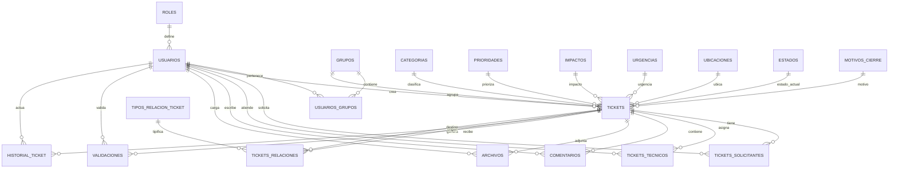
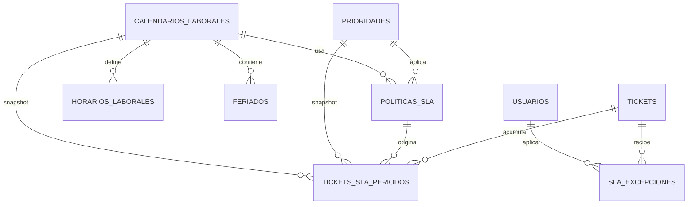
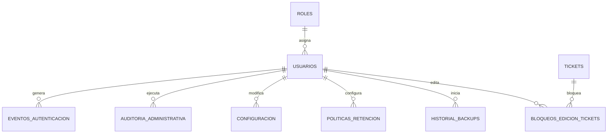

# 09. Modelo de Datos

## WorkDesk

---

## 1. Información del documento

| Campo | Valor |
| --- | --- |
| Proyecto | WorkDesk |
| Documento | Modelo de Datos |
| Archivo | `09_modelo_de_datos.md` |
| Versión | 1.1 |
| Estado | Definitivo |
| Alcance | MVP |
| Motor objetivo | PostgreSQL |
| Idioma de nombres | Español |
| Convención principal | `snake_case` en tablas y columnas |
| Dependencias | `04_requisitos_funcionales.md`, `05_requisitos_no_funcionales.md`, `06_reglas_de_negocio.md`, `07_casos_de_uso.md`, `08_flujo_de_tickets.md` |

---

# 2. Propósito

El presente documento define el **modelo de datos del MVP de WorkDesk**.

Su objetivo es transformar los requisitos funcionales, requisitos no funcionales, reglas de negocio, casos de uso y flujo de tickets en una estructura de persistencia coherente, trazable y preparada para ser implementada sobre PostgreSQL.

Este documento define:

- Entidades principales del dominio.
- Tablas y responsabilidades.
- Campos relevantes.
- Claves primarias y foráneas.
- Cardinalidades.
- Reglas de nulabilidad.
- Restricciones de integridad.
- Estrategia de historial y auditoría.
- Persistencia de SLA.
- Persistencia de archivos adjuntos.
- Configuración administrativa.
- Políticas de retención.
- Concurrencia sobre tickets.
- Registro de respaldos.
- Índices recomendados.
- Elementos expresamente excluidos del modelo del MVP.

El documento **no define todavía** controladores, servicios, endpoints, estructura de código Python, ORM, API, estrategia concreta de autenticación, despliegue ni infraestructura. Dichos aspectos corresponden principalmente a `10_arquitectura.md`.

---

# 3. Fuentes y criterio de precedencia

El modelo se deriva de los documentos definitivos de WorkDesk y de las decisiones cerradas durante la etapa de diseño del modelo de datos.

En caso de existir diferencias históricas entre respuestas preliminares y decisiones posteriores, se aplica el siguiente orden:

1. Decisiones finales del cuestionario de cierre del modelo de datos.
2. Documentos `04` a `08` ajustados después de la auditoría.
3. Decisiones del cuestionario original que no hayan sido reemplazadas.
4. Decisiones técnicas de este documento necesarias para materializar el modelo sin alterar el comportamiento funcional definido.

Las decisiones puramente técnicas que todavía admiten más de una implementación válida deberán terminar de precisarse en `10_arquitectura.md` o durante las migraciones iniciales.

---

# 4. Principios del modelo de datos

El modelo seguirá el siguiente orden de prioridades:

1. **Integridad de datos.**
2. **Trazabilidad.**
3. **Flexibilidad y parametrización controlada.**
4. **Facilidad de mantenimiento.**
5. **Simplicidad.**
6. **Escalabilidad futura.**
7. **Rendimiento.**

El principio rector es:

> Construir un modelo suficientemente sólido para representar correctamente WorkDesk y permitir su evolución, evitando sobreingeniería innecesaria en el MVP.

De este principio se derivan las siguientes reglas:

- La base de datos deberá proteger la integridad referencial.
- La eliminación lógica será la estrategia normal para entidades modificables que requieran conservación histórica.
- La eliminación física será excepcional.
- Los registros históricos no deberán sobrescribirse mediante operaciones normales; una corrección excepcional deberá representarse mediante un evento compensatorio o un procedimiento controlado y auditable.
- Las entidades append-only no recibirán campos de modificación que no tengan sentido.
- Los catálogos configurables conservarán registros inactivos para no romper referencias históricas.
- `JSONB` solo se utilizará cuando la estructura variable del dato lo justifique.
- No se crearán tablas para conceptos que todavía no forman parte funcional del MVP.

---

# 5. Convenciones técnicas

## 5.1 Nombres

Las tablas y columnas utilizarán:

```text
snake_case
```

Ejemplos:

```text
usuarios
fecha_creacion
prioridad_id
cerrado_automaticamente
```

Los nombres de tablas estarán en plural siempre que resulte natural.

Las tablas asociativas se normalizan también a plural en este documento, aunque en cuestionarios anteriores hayan aparecido ejemplos en singular.

Ejemplos:

```text
usuarios_grupos
tickets_solicitantes
tickets_tecnicos
tickets_relaciones
```

---

## 5.2 Claves primarias

Las entidades con identidad propia utilizarán, como regla general:

```text
id BIGINT GENERATED BY DEFAULT AS IDENTITY PRIMARY KEY
```

El `id` es un identificador técnico interno y no deberá utilizarse como identificador visible del ticket para el usuario final.

Las tablas asociativas simples podrán utilizar claves compuestas cuando no necesiten identidad propia. Sin embargo, una asociación que posea ciclo de vida, historial temporal, atributos propios o necesidad de ser referenciada podrá utilizar su propio `BIGINT id`.

Esta regla permite mantener simplicidad sin forzar una estrategia idéntica para todas las tablas.

## 5.3 Identificador público de ticket

Cada ticket tendrá:

```text
public_id VARCHAR NOT NULL UNIQUE
```

En el MVP el valor almacenado será correlativo y simple:

```text
1
2
3
4
...
```

La interfaz lo presentará como:

```text
#1
#2
#3
#4
...
```

El carácter `#` no necesita almacenarse en la base de datos.

El uso de `VARCHAR` permite que una futura evolución pueda utilizar identificadores como:

```text
WD-000001
EMPRESA-000001
```

sin modificar la clave primaria interna.

La generación correlativa deberá utilizar un mecanismo seguro frente a concurrencia, preferentemente una secuencia de PostgreSQL o mecanismo equivalente definido en arquitectura.

`public_id` debe tratarse como identificador, no como criterio general de orden cronológico. Para orden temporal se utilizarán `tickets.id` o las fechas correspondientes. Si una consulta necesita ordenar numéricamente el formato simple del MVP, deberá hacerlo de forma explícita y no mediante ordenamiento lexicográfico de `VARCHAR`.

---

## 5.4 Fechas y horas

Las fechas que representan instantes utilizarán:

```text
TIMESTAMPTZ
```

La información deberá almacenarse de forma consistente y tratarse internamente en UTC.

La conversión a hora local se realizará en la capa correspondiente de presentación.

Los campos exclusivamente de calendario utilizarán tipos apropiados:

```text
DATE
TIME
```

---

## 5.5 Claves foráneas

La política de eliminación de referencias será conservadora por la prioridad de integridad y trazabilidad de WorkDesk.

Como regla general:

- `ON DELETE RESTRICT` / `NO ACTION` será el comportamiento predeterminado cuando una eliminación pueda afectar integridad funcional o histórica.
- `ON DELETE SET NULL` solo se utilizará cuando la relación sea opcional y la pérdida de la referencia no destruya el significado del registro histórico o transaccional.
- `ON DELETE CASCADE` será excepcional y se reservará para hijos puramente dependientes, sin significado independiente ni impacto en la trazabilidad.

La eliminación física excepcional deberá realizarse mediante un procedimiento expresamente controlado y no mediante operaciones CRUD ordinarias.

## 5.6 JSONB

`JSONB` podrá utilizarse únicamente cuando la información tenga estructura variable o heterogénea y una tabla relacional separada no aporte claridad suficiente.

Usos justificados dentro de este modelo incluyen principalmente:

- Valores anteriores y nuevos de eventos históricos heterogéneos.
- Contexto adicional de historial.
- Configuraciones complejas que no justifiquen una tabla propia.

No se utilizará `JSONB` para reemplazar catálogos o relaciones claramente estructuradas.

---

# 6. Estrategia de auditoría por naturaleza de entidad

No todas las tablas recibirán automáticamente el mismo conjunto de campos.

## 6.1 Entidades modificables

Cuando corresponda podrán incluir:

```text
fecha_creacion
usuario_creacion_id
fecha_modificacion
usuario_modificacion_id
activo
fecha_desactivacion
usuario_desactivacion_id
```

No todos estos campos son obligatorios para todas las entidades.

---

## 6.2 Entidades históricas y entidades de evolución controlada

Las entidades históricas estrictas, como:

- `historial_ticket`
- `auditoria_administrativa`
- `eventos_autenticacion`

no deberán ser editables mediante el flujo normal de la aplicación. Una corrección excepcional no sobrescribe silenciosamente el hecho original: deberá generar un evento compensatorio o seguir un procedimiento controlado y auditable.

Otras entidades conservan valor histórico pero poseen una evolución de estado limitada:

- `notificaciones`: conserva su contenido original, pero puede cambiar su estado de lectura.
- `historial_backups`: puede evolucionar mientras el respaldo se encuentra en ejecución y se vuelve inmutable al finalizar.
- `tickets_sla_periodos`: el período vigente puede cerrarse; una vez cerrado se trata como histórico y no se sobrescribe.

No se aplicarán campos de modificación o desactivación universales a todas las tablas; cada entidad tendrá únicamente los que correspondan a su naturaleza.

# 7. Vista general del modelo

El modelo se organiza en los siguientes dominios:

| Dominio | Entidades principales |
| --- | --- |
| Identidad y seguridad | `roles`, `usuarios`, `eventos_autenticacion` |
| Organización operativa | `grupos`, `usuarios_grupos` |
| Clasificación | `categorias`, `prioridades`, `impactos`, `urgencias`, `ubicaciones` |
| Flujo | `estados`, `transiciones_estados`, `motivos_espera`, `motivos_cierre` |
| Ticket | `tickets`, `tickets_solicitantes`, `tickets_tecnicos` |
| Resolución y colaboración | `validaciones`, `comentarios`, `archivos` |
| Relaciones de tickets | `tipos_relacion_ticket`, `tickets_relaciones` |
| SLA | `politicas_sla`, `tickets_sla_periodos`, `sla_excepciones` |
| Calendario laboral | `calendarios_laborales`, `horarios_laborales`, `feriados` |
| Comunicación | `notificaciones` |
| Conocimiento | `articulos_conocimiento`, `tickets_articulos_conocimiento` |
| Trazabilidad | `historial_ticket`, `auditoria_administrativa` |
| Administración | `configuracion`, `politicas_retencion` |
| Concurrencia | `bloqueos_edicion_tickets` |
| Recuperación | `historial_backups` |

---

# 8. Diagrama conceptual principal



---

# 9. Entidades de identidad y seguridad

## 9.1 `roles`

Representa los cuatro roles estructurales del MVP.

### Registros iniciales

```text
SOLICITANTE
TECNICO
SUPERVISOR
ADMINISTRADOR
```

### Campos

| Campo | Tipo | Nulo | Descripción |
| --- | --- | --- | --- |
| `id` | BIGINT | No | PK interna. |
| `codigo` | VARCHAR | No | Código estable y único. |
| `nombre` | VARCHAR | No | Nombre visible. |
| `descripcion` | TEXT | Sí | Descripción funcional. |

### Restricciones

- `codigo` UNIQUE.
- Los cuatro roles son estructurales en el MVP y no podrán crearse, eliminarse, desactivarse ni sustituirse mediante configuración administrativa ordinaria.
- No existe una tabla física de permisos.
- No existe `usuarios_roles` en el MVP.
- Cada usuario posee exactamente un rol actual mediante `usuarios.rol_id`.

Los permisos concretos se controlan por la aplicación y se detallarán en arquitectura.

---

## 9.2 `usuarios`

Representa las cuentas de usuario de WorkDesk.

### Campos

| Campo | Tipo | Nulo | Descripción |
| --- | --- | --- | --- |
| `id` | BIGINT | No | PK interna. |
| `nombre` | VARCHAR | No | Nombre del usuario. |
| `apellido` | VARCHAR | No | Apellido del usuario. |
| `username` | VARCHAR | No | Identificador principal de autenticación. |
| `email` | VARCHAR | No | Identificador secundario único. |
| `telefono` | VARCHAR | Sí | Dato opcional. |
| `cargo` | VARCHAR | Sí | Dato opcional. |
| `departamento_area` | VARCHAR | Sí | Texto informativo opcional; no crea entidad Departamento en MVP. |
| `password_hash` | VARCHAR | No | Hash de contraseña; nunca texto plano. |
| `rol_id` | BIGINT | No | FK a `roles`. |
| `token_version` | INTEGER | No | Soporte para invalidación global de credenciales/sesiones stateless. Default 1. |
| `intentos_fallidos` | INTEGER | No | Soporte de política de bloqueo. Default 0. |
| `bloqueado_hasta` | TIMESTAMPTZ | Sí | Fin de bloqueo temporal de autenticación. |
| `activo` | BOOLEAN | No | Indica si la cuenta está habilitada. |
| `fecha_creacion` | TIMESTAMPTZ | No | Creación. |
| `usuario_creacion_id` | BIGINT | Sí | Administrador creador; nullable para usuario inicial del sistema. |
| `fecha_modificacion` | TIMESTAMPTZ | Sí | Última modificación. |
| `usuario_modificacion_id` | BIGINT | Sí | Usuario que modificó. |
| `fecha_desactivacion` | TIMESTAMPTZ | Sí | Desactivación lógica. |
| `usuario_desactivacion_id` | BIGINT | Sí | Responsable de desactivación. |

### Restricciones

- `username` UNIQUE.
- `email` UNIQUE.
- `rol_id` obligatorio.
- Un usuario desactivado conserva todas sus referencias históricas.
- Un cambio de rol no crea una tabla de historial de roles; se registra en `auditoria_administrativa`.
- `token_version` no implica una tabla persistente de sesiones.

### Nota sobre campos de seguridad

`intentos_fallidos` y `bloqueado_hasta` soportan la limitación de intentos y el bloqueo temporal definidos para el MVP. `token_version` soporta la invalidación de sesiones/credenciales anteriores sin exigir una tabla persistente de sesiones.

Los campos `usuario_creacion_id`, `usuario_modificacion_id` y `usuario_desactivacion_id` identifican actores de operaciones concretas y complementan, pero no sustituyen, el historial completo de `auditoria_administrativa`.

Si un usuario Técnico cambia a un rol que ya no participa operacionalmente en grupos, sus membresías activas deberán finalizarse preservando los registros históricos y auditando el cambio. La estrategia exacta de autenticación se cerrará en `10_arquitectura.md`.

---

## 9.3 `eventos_autenticacion`

Registro especializado y append-only de eventos de autenticación.

### Eventos esperados

- Inicio de sesión exitoso.
- Inicio de sesión fallido.
- Cierre de sesión.
- Cambio de contraseña.
- Bloqueo temporal.
- Desbloqueo.
- Invalidación de credenciales/sesiones cuando corresponda.

### Campos

| Campo | Tipo | Nulo | Descripción |
| --- | --- | --- | --- |
| `id` | BIGINT | No | PK. |
| `usuario_id` | BIGINT | Sí | FK a `usuarios`; puede ser NULL si no se identifica una cuenta válida. |
| `identificador_intentado` | VARCHAR | Sí | Username/identificador usado en el intento, cuando corresponda. Nunca almacena contraseñas ni tokens. |
| `tipo_evento` | VARCHAR | No | Código controlado del evento. |
| `resultado` | VARCHAR | No | Código controlado de resultado, por ejemplo `EXITOSO` o `FALLIDO`. |
| `ip_origen` | VARCHAR | Sí | IP de origen. |
| `user_agent` | VARCHAR | Sí | Navegador/cliente. |
| `detalle` | TEXT | Sí | Contexto controlado. |
| `fecha_hora` | TIMESTAMPTZ | No | Momento del evento. |

### Reglas

- `tipo_evento` y `resultado` utilizarán dominios/códigos definidos por la aplicación para impedir variantes semánticamente duplicadas.
- `identificador_intentado` permite conservar contexto incluso cuando `usuario_id` sea NULL.
- Nunca se almacenarán contraseñas, tokens ni credenciales completas en esta entidad.
- Los eventos puramente de autenticación **no deberán duplicarse sistemáticamente** en `auditoria_administrativa`.
- Las acciones administrativas de seguridad continúan registrándose en auditoría cuando corresponda.

# 10. Organización operativa

## 10.1 `grupos`

Representa grupos o colas de atención.

### Campos

| Campo | Tipo | Nulo | Descripción |
| --- | --- | --- | --- |
| `id` | BIGINT | No | PK. |
| `nombre` | VARCHAR | No | Nombre único del grupo dentro del MVP. |
| `descripcion` | TEXT | Sí | Descripción. |
| `activo` | BOOLEAN | No | Disponibilidad actual. |
| `fecha_creacion` | TIMESTAMPTZ | No | Creación. |
| `usuario_creacion_id` | BIGINT | Sí | Creador. |
| `fecha_modificacion` | TIMESTAMPTZ | Sí | Modificación. |
| `usuario_modificacion_id` | BIGINT | Sí | Modificador. |
| `fecha_desactivacion` | TIMESTAMPTZ | Sí | Desactivación. |
| `usuario_desactivacion_id` | BIGINT | Sí | Responsable. |

### Reglas

- `nombre` será UNIQUE en el ámbito del MVP de una sola organización.
- Un ticket puede crearse sin grupo.
- El grupo representa organización y responsabilidad formal, no una jerarquía obligatoria de niveles.
- La pertenencia de un Técnico a un grupo **no limita por defecto su acceso operativo global** a tickets.
- Solo Técnicos participan operacionalmente en grupos en el MVP.
- El escalamiento a un “nivel superior” se representa funcionalmente mediante cambios de grupo/técnico e historial; no se incorpora `nivel_atencion` hasta que exista una jerarquía formal definida.

## 10.2 `usuarios_grupos`

Tabla temporal N:M entre técnicos y grupos.

### Campos

| Campo | Tipo | Nulo | Descripción |
| --- | --- | --- | --- |
| `id` | BIGINT | No | PK. |
| `usuario_id` | BIGINT | No | FK a `usuarios`. |
| `grupo_id` | BIGINT | No | FK a `grupos`. |
| `fecha_inicio` | TIMESTAMPTZ | No | Inicio de pertenencia. |
| `fecha_fin` | TIMESTAMPTZ | Sí | Fin; NULL indica pertenencia vigente. |
| `asignado_por_usuario_id` | BIGINT | Sí | Administrador que realizó la asociación. |
| `retirado_por_usuario_id` | BIGINT | Sí | Responsable del retiro. |
| `motivo_retiro` | TEXT | Sí | Contexto opcional. |

### Regla de vigencia

```text
fecha_fin IS NULL
```

indica pertenencia actual.

### Restricción recomendada

Índice único parcial para impedir dos pertenencias activas idénticas:

```text
UNIQUE (usuario_id, grupo_id) WHERE fecha_fin IS NULL
```

También deberá cumplirse:

```text
fecha_fin IS NULL OR fecha_fin >= fecha_inicio
```

La creación de una membresía activa deberá validar en backend que `usuario_id` corresponda a un usuario habilitado para desempeñarse como Técnico. Si posteriormente cambia de rol, no se elimina el historial: se cierran las membresías activas cuando corresponda y se conserva la trazabilidad.

---

# 11. Catálogos de clasificación

## 11.1 `categorias`

### Campos

| Campo | Tipo | Nulo | Descripción |
| --- | --- | --- | --- |
| `id` | BIGINT | No | PK. |
| `codigo` | VARCHAR | Sí | Código estable opcional. |
| `nombre` | VARCHAR | No | Nombre visible. |
| `descripcion` | TEXT | Sí | Descripción. |
| `orden` | INTEGER | Sí | Orden de presentación. |
| `activo` | BOOLEAN | No | Vigencia. |
| `fecha_creacion` | TIMESTAMPTZ | No | Creación. |
| `usuario_creacion_id` | BIGINT | Sí | Creador. |
| `fecha_modificacion` | TIMESTAMPTZ | Sí | Modificación. |
| `usuario_modificacion_id` | BIGINT | Sí | Modificador. |

### Restricciones y dato inicial obligatorio

- `codigo` será UNIQUE cuando tenga valor.
- El nombre de categoría deberá ser lógicamente único dentro del MVP para evitar duplicados indistinguibles.
- Debe existir una categoría operativa de respaldo con código estable:

```text
SIN_CLASIFICAR
```

con nombre visible equivalente a `Sin clasificar`.

La categoría de un ticket nunca deberá quedar sin referencia válida.

---

## 11.2 `prioridades`

### Registros base

```text
Baja
Media
Alta
Crítica
```

### Campos

| Campo | Tipo | Nulo | Descripción |
| --- | --- | --- | --- |
| `id` | BIGINT | No | PK. |
| `codigo` | VARCHAR | Sí | Código estable. |
| `nombre` | VARCHAR | No | Nombre visible. |
| `descripcion` | TEXT | Sí | Descripción. |
| `nivel` | INTEGER | No | Valor ordinal utilizado para ordenar y comparar prioridades; no impone una cola rígida de trabajo. |
| `color` | VARCHAR | Sí | Representación visual. |
| `activo` | BOOLEAN | No | Vigencia. |
| `fecha_creacion` | TIMESTAMPTZ | No | Creación. |
| `usuario_creacion_id` | BIGINT | Sí | Creador. |
| `fecha_modificacion` | TIMESTAMPTZ | Sí | Modificación. |
| `usuario_modificacion_id` | BIGINT | Sí | Modificador. |

### Reglas

- Cada ticket debe poseer prioridad desde la creación.
- La prioridad es manual.
- No se calcula obligatoriamente desde impacto y urgencia.
- Después de creado el ticket, el Técnico no puede modificar la prioridad; Supervisor y Administrador sí.
- `nivel > 0`.
- Los niveles activos no deberán duplicarse.
- El nivel es una referencia ordinal para ordenamiento, filtros, métricas y alertas; no impide atender tickets de menor prioridad.

---

## 11.3 `impactos`

Catálogo configurable y opcional en los tickets.

### Campos

```text
id
nombre
descripcion
nivel
activo
fecha_creacion
usuario_creacion_id
fecha_modificacion
usuario_modificacion_id
```

---

## 11.4 `urgencias`

Catálogo configurable y opcional en los tickets.

### Campos

```text
id
nombre
descripcion
nivel
activo
fecha_creacion
usuario_creacion_id
fecha_modificacion
usuario_modificacion_id
```

### Regla conjunta de Impacto/Urgencia

`tickets.impacto_id` y `tickets.urgencia_id` serán nullable.

Su ausencia no impide crear, gestionar, resolver ni cerrar un ticket.

---

## 11.5 `ubicaciones`

Catálogo configurable de ubicaciones físicas.

### Campos

| Campo | Tipo | Nulo | Descripción |
| --- | --- | --- | --- |
| `id` | BIGINT | No | PK. |
| `nombre` | VARCHAR | No | Nombre. |
| `descripcion` | TEXT | Sí | Detalle. |
| `tipo` | VARCHAR | Sí | Sucursal, oficina, edificio, piso, área, etc. |
| `activo` | BOOLEAN | No | Vigencia. |
| `fecha_creacion` | TIMESTAMPTZ | No | Creación. |
| `usuario_creacion_id` | BIGINT | Sí | Creador. |
| `fecha_modificacion` | TIMESTAMPTZ | Sí | Modificación. |
| `usuario_modificacion_id` | BIGINT | Sí | Modificador. |

### Regla

`tickets.ubicacion_id` es nullable a nivel físico.

La obligatoriedad de ubicación se controla mediante configuración y validación de negocio, no mediante `NOT NULL`, porque puede variar administrativamente.

`ubicaciones.tipo` utilizará valores controlados por la aplicación/configuración para evitar variantes semánticamente duplicadas, sin crear una tabla adicional de tipos en el MVP.

La desactivación de una ubicación —al igual que la de otros catálogos— no modifica referencias históricas existentes; únicamente impide su selección en nuevas operaciones ordinarias.

---

# 12. Estados y transiciones

## 12.1 `estados`

Contiene exactamente seis estados estructurales.

### Códigos base

```text
NUEVO
ASIGNADO
EN_PROGRESO
EN_ESPERA
RESUELTO
CERRADO
```

### Campos

| Campo | Tipo | Nulo | Descripción |
| --- | --- | --- | --- |
| `id` | BIGINT | No | PK. |
| `codigo` | VARCHAR | No | Código estructural e inmutable. |
| `nombre_visible` | VARCHAR | No | Nombre configurable. |
| `descripcion` | TEXT | Sí | Ayuda contextual. |
| `color` | VARCHAR | Sí | Atributo visual. |
| `orden` | INTEGER | No | Orden visual. |

### Restricciones

- `codigo` UNIQUE.
- Los seis códigos estructurales forman parte del dominio de WorkDesk y no podrán crearse, eliminarse, sustituirse ni modificarse mediante configuración administrativa ordinaria.
- Los atributos visibles permitidos sí podrán modificarse conforme a las reglas de negocio.
- `Reabierto`, `Cancelado` y `Duplicado` no son estados estructurales.

---

## 12.2 `transiciones_estados`

Representa las transiciones que se encuentran habilitadas dentro del conjunto estructural válido.

### Campos

| Campo | Tipo | Nulo | Descripción |
| --- | --- | --- | --- |
| `id` | BIGINT | No | PK. |
| `estado_origen_id` | BIGINT | No | FK a `estados`. |
| `estado_destino_id` | BIGINT | No | FK a `estados`. |
| `accion` | VARCHAR | No | Código/mecanismo funcional que provoca la transición. |
| `activa` | BOOLEAN | No | Permite habilitar/deshabilitar la transición válida. |
| `descripcion` | TEXT | Sí | Contexto. |
| `fecha_modificacion` | TIMESTAMPTZ | Sí | Última modificación. |
| `usuario_modificacion_id` | BIGINT | Sí | Administrador que modificó. |

### Restricciones

- UNIQUE (`estado_origen_id`, `estado_destino_id`, `accion`).
- No almacena permisos arbitrarios.
- `accion` identifica el mecanismo funcional; un mismo par origen/destino puede existir con acciones distintas cuando el flujo lo requiera (por ejemplo validación, auto-cierre o cierre excepcional).
- La aplicación deberá validar que cualquier modificación permanezca dentro del conjunto estructural permitido por WorkDesk.
- Los roles autorizados para ejecutar cada acción siguen definidos por la lógica de autorización de la aplicación.

### Transiciones predeterminadas relevantes

Entre otras, el MVP contempla:

```text
Nuevo -> Asignado
Nuevo -> En progreso
Nuevo -> Resuelto
Nuevo -> Cerrado (cierre directo)
Asignado -> En progreso
Asignado -> Resuelto
Asignado -> Cerrado (cierre directo)
En progreso -> En espera
En progreso -> Resuelto
En progreso -> Cerrado (cierre directo)
En espera -> En progreso
En espera -> Resuelto
En espera -> Cerrado (cierre directo)
Resuelto -> Cerrado
Resuelto -> En progreso (reapertura/rechazo)
Cerrado -> En progreso (reapertura permitida)
```

El detalle operativo definitivo continúa siendo `08_flujo_de_tickets.md`.

---

## 12.3 `motivos_espera`

Catálogo configurable y **opcional**.

### Campos

```text
id
codigo
nombre
descripcion
permite_texto_otro
activo
fecha_creacion
usuario_creacion_id
fecha_modificacion
usuario_modificacion_id
```

### Regla

Entrar a `En espera` no exige un motivo.

Cuando se utilice un motivo, este deberá conservarse en el historial del evento. La opción `OTRO` podrá complementarse con texto libre. No se añade `motivo_espera_id` a `tickets`, porque un ticket puede atravesar múltiples episodios de espera. Si la interfaz necesita mostrar el motivo vigente, deberá obtenerlo del último evento aplicable de entrada a `EN_ESPERA`.

---

## 12.4 `motivos_cierre`

Catálogo configurable de motivos de cierre.

### Valores base esperados

```text
RESOLUCION_VALIDADA
CIERRE_DIRECTO
INACTIVIDAD
DUPLICADO
CANCELACION
CIERRE_EXCEPCIONAL
```

### Campos

```text
id
codigo
nombre
descripcion
orden
activo
fecha_creacion
usuario_creacion_id
fecha_modificacion
usuario_modificacion_id
```

### Regla

`motivos_cierre` funciona como catálogo de **clasificación del cierre**, pudiendo representar causas o mecanismos funcionales de finalización.

`motivo_cierre_id` podrá ser NULL mientras el ticket no esté cerrado. Cuando el estado actual sea `CERRADO`, deberá existir un `motivo_cierre_id` válido.

---

# 13. Entidad central: `tickets`

`tickets` es la entidad principal del dominio WorkDesk.

## 13.1 Campos

| Campo | Tipo | Nulo | Descripción |
| --- | --- | --- | --- |
| `id` | BIGINT | No | PK técnica. |
| `public_id` | VARCHAR | No | Identificador público correlativo. |
| `titulo` | VARCHAR | No | Resumen del ticket. |
| `descripcion` | TEXT | No | Descripción principal. |
| `creado_por_usuario_id` | BIGINT | No | FK a `usuarios`; creador original permanente. |
| `categoria_id` | BIGINT | No | FK a `categorias`. |
| `impacto_id` | BIGINT | Sí | FK a `impactos`. |
| `urgencia_id` | BIGINT | Sí | FK a `urgencias`. |
| `prioridad_id` | BIGINT | No | FK a `prioridades`. |
| `estado_id` | BIGINT | No | FK a `estados`. |
| `ubicacion_id` | BIGINT | Sí | FK a `ubicaciones`. |
| `grupo_id` | BIGINT | Sí | FK a `grupos`. |
| `resolucion` | TEXT | Sí | Texto opcional de solución. |
| `fecha_creacion` | TIMESTAMPTZ | No | Creación. |
| `fecha_modificacion` | TIMESTAMPTZ | Sí | Última modificación operativa. |
| `usuario_modificacion_id` | BIGINT | Sí | Último modificador cuando corresponda. |
| `fecha_resolucion` | TIMESTAMPTZ | Sí | Última fecha en que quedó Resuelto. |
| `fecha_cierre` | TIMESTAMPTZ | Sí | Fecha de cierre actual. |
| `cerrado_por_usuario_id` | BIGINT | Sí | Usuario que cerró; NULL si fue automático. |
| `motivo_cierre_id` | BIGINT | Sí | FK a `motivos_cierre`. |
| `cerrado_automaticamente` | BOOLEAN | No | Default FALSE. |
| `version` | INTEGER | No | Control optimista; default 1. |
| `activo` | BOOLEAN | No | Conservación/eliminación lógica administrativa. |
| `fecha_desactivacion` | TIMESTAMPTZ | Sí | Desactivación lógica excepcional. |
| `usuario_desactivacion_id` | BIGINT | Sí | Responsable. |

---

## 13.2 Reglas estructurales

- `public_id` UNIQUE y permanente.
- `creado_por_usuario_id` no cambia aunque cambien los solicitantes.
- `categoria_id` siempre válido; se utiliza `Sin clasificar` cuando corresponda.
- `prioridad_id` obligatorio desde la creación.
- `impacto_id` y `urgencia_id` opcionales.
- `ubicacion_id` físicamente nullable.
- `grupo_id` nullable en la creación.
- No existe `solicitante_id` directo.
- No existe `tecnico_id` directo.
- Un ticket puede no tener solicitantes.
- Un ticket puede no tener técnicos asignados.
- La ausencia de asignación no impide que un Técnico autorizado opere el ticket.
- `version` aumenta en cada actualización relevante de la fila para el control optimista.
- Los campos de cierre no reemplazan al historial.
- `activo = FALSE` representa una desactivación administrativa excepcional del registro y no equivale al estado `CERRADO`, a `CANCELACION` ni a otra finalización operativa.
- Desactivar un catálogo no invalida los tickets históricos que ya lo referencian; únicamente impide seleccionar ese valor en nuevas operaciones normales.
- Si `estado = CERRADO`, `fecha_cierre` y `motivo_cierre_id` deben existir.
- En un cierre automático, `cerrado_automaticamente = TRUE` y `cerrado_por_usuario_id` puede ser NULL; en un cierre humano normal, `cerrado_automaticamente = FALSE` y `cerrado_por_usuario_id` deberá identificar al actor.

---

# 14. Solicitantes

## 14.1 `tickets_solicitantes`

Tabla N:M temporal entre tickets y usuarios solicitantes.

### Campos

| Campo | Tipo | Nulo | Descripción |
| --- | --- | --- | --- |
| `id` | BIGINT | No | PK. |
| `ticket_id` | BIGINT | No | FK a `tickets`. |
| `solicitante_id` | BIGINT | No | FK a `usuarios`. |
| `fecha_asociacion` | TIMESTAMPTZ | No | Inicio de participación. |
| `asociado_por_usuario_id` | BIGINT | Sí | Usuario que realizó la asociación. |
| `fecha_retiro` | TIMESTAMPTZ | Sí | Fin de participación. |
| `retirado_por_usuario_id` | BIGINT | Sí | Usuario que retiró. |

### Reglas

- Un ticket puede tener 0..N solicitantes.
- Un usuario puede ser solicitante de 0..N tickets.
- La participación actual se obtiene con `fecha_retiro IS NULL`.
- Los registros no se eliminan al retirar a un solicitante.
- El creador no se convierte automáticamente en solicitante.

### Restricción recomendada

```text
UNIQUE (ticket_id, solicitante_id) WHERE fecha_retiro IS NULL
```

Además:

```text
fecha_retiro IS NULL OR fecha_retiro >= fecha_asociacion
```

---

# 15. Técnicos y asignaciones

## 15.1 `tickets_tecnicos`

Tabla N:M temporal de asignaciones formales.

### Campos

| Campo | Tipo | Nulo | Descripción |
| --- | --- | --- | --- |
| `id` | BIGINT | No | PK. |
| `ticket_id` | BIGINT | No | FK a `tickets`. |
| `tecnico_id` | BIGINT | No | FK a `usuarios`. |
| `fecha_asignacion` | TIMESTAMPTZ | No | Inicio de asignación. |
| `asignado_por_usuario_id` | BIGINT | Sí | Usuario que asignó. |
| `fecha_desasignacion` | TIMESTAMPTZ | Sí | Fin; NULL indica asignación actual. |
| `desasignado_por_usuario_id` | BIGINT | Sí | Responsable. |
| `motivo_desasignacion` | TEXT | Sí | Contexto opcional. |

### Reglas

- Un ticket puede tener 0..N Técnicos simultáneos.
- Un Técnico puede tener 0..N tickets simultáneos.
- No existe límite obligatorio de tickets por Técnico.
- Una carga alta no bloquea asignaciones.
- La asignación es organizativa; no constituye requisito de autorización operativa por defecto.
- Reabrir un ticket no elimina automáticamente a sus Técnicos anteriores.
- Las reasignaciones masivas cierran asociaciones antiguas y crean las nuevas, sin sobrescribir historial.

### Restricción recomendada

```text
UNIQUE (ticket_id, tecnico_id) WHERE fecha_desasignacion IS NULL
```

Además:

```text
fecha_desasignacion IS NULL OR fecha_desasignacion >= fecha_asignacion
```

Al crear una asignación activa, el backend deberá validar que `tecnico_id` corresponda a un usuario habilitado para desempeñarse como Técnico. Un cambio posterior de rol no borra asignaciones históricas; las asociaciones activas se cierran cuando corresponda y el cambio se audita.

---

# 16. Validación de resolución

## 16.1 `validaciones`

Entidad independiente para registrar la respuesta de los solicitantes frente a una resolución.

### Campos

| Campo | Tipo | Nulo | Descripción |
| --- | --- | --- | --- |
| `id` | BIGINT | No | PK. |
| `ticket_id` | BIGINT | No | FK a `tickets`. |
| `solicitante_id` | BIGINT | No | FK a `usuarios`. |
| `ciclo_resolucion` | INTEGER | No | Número de la resolución a la que corresponde la validación; comienza en 1. |
| `tipo_validacion` | VARCHAR | No | `ACEPTADA` o `RECHAZADA`. |
| `motivo_rechazo` | TEXT | Condicional | Obligatorio cuando la validación es rechazada. |
| `comentario_adicional` | TEXT | Sí | Información adicional. |
| `fecha_validacion` | TIMESTAMPTZ | No | Fecha/hora. |

### Reglas

- Una validación positiva de cualquiera de los solicitantes autorizados puede cerrar el ticket.
- Una validación negativa requiere motivo.
- `ciclo_resolucion >= 1`.
- Cada nueva entrada a `RESUELTO` incrementa conceptualmente el ciclo de resolución del ticket.
- Un mismo solicitante podrá validar nuevamente el ticket en ciclos posteriores, pero no registrar respuestas duplicadas para el mismo ciclo.
- Se recomienda:

```text
UNIQUE (ticket_id, solicitante_id, ciclo_resolucion)
```

- No se crea una entidad `resoluciones` separada en el MVP; el ciclo, los campos actuales de `tickets` y `historial_ticket` permiten distinguir las resoluciones sucesivas.
- El cambio de estado derivado también queda en `historial_ticket`.

# 17. Comentarios y notas internas

## 17.1 `comentarios`

Una única entidad representa comentarios públicos y notas internas.

### Campos

| Campo | Tipo | Nulo | Descripción |
| --- | --- | --- | --- |
| `id` | BIGINT | No | PK. |
| `ticket_id` | BIGINT | No | FK a `tickets`. |
| `autor_usuario_id` | BIGINT | No | FK a `usuarios`. |
| `tipo` | VARCHAR | No | `PUBLICO` o `INTERNO`. |
| `contenido` | TEXT | No | Texto actual. |
| `fecha_creacion` | TIMESTAMPTZ | No | Publicación. |
| `fecha_modificacion` | TIMESTAMPTZ | Sí | Última edición. |
| `usuario_modificacion_id` | BIGINT | Sí | Editor, si no fue el autor o para trazabilidad. |
| `editado` | BOOLEAN | No | Default FALSE. |
| `activo` | BOOLEAN | No | Eliminación lógica; default TRUE. |
| `fecha_eliminacion` | TIMESTAMPTZ | Sí | Eliminación lógica. |
| `usuario_eliminacion_id` | BIGINT | Sí | Responsable. |

### Reglas

- Solicitantes solo pueden acceder a `PUBLICO`.
- Técnicos, Supervisores y Administradores pueden acceder a notas internas según permisos.
- El autor puede editar dentro del período configurado, por defecto 30 minutos.
- Supervisor y Administrador pueden editar comentarios de terceros según las reglas funcionales.
- `tipo` se define al crear el comentario y será inmutable mediante edición ordinaria; cambiar `PUBLICO` ↔ `INTERNO` podría alterar retroactivamente la visibilidad.
- Toda edición y eliminación debe generar historial con contenido anterior/nuevo cuando corresponda.
- En una edición, el historial deberá conservar como mínimo el identificador del comentario, contenido anterior y nuevo, actor y fecha.
- En una eliminación lógica, deberá conservar como mínimo el identificador, contenido previo, tipo, actor y fecha.
- No se crea una tabla separada de versiones de comentarios en el MVP; el historial general conserva las modificaciones.
- Cuando `activo = TRUE`, `fecha_eliminacion` y `usuario_eliminacion_id` normalmente serán NULL. Si `activo = FALSE`, deberá existir `fecha_eliminacion`; para eliminación humana se registrará `usuario_eliminacion_id` y para procesos automáticos el actor Sistema quedará en historial.

---

# 18. Archivos adjuntos

## 18.1 `archivos`

La base de datos almacena **metadatos**, no el binario del archivo.

El archivo físico se mantiene en almacenamiento local protegido.

### Campos

| Campo | Tipo | Nulo | Descripción |
| --- | --- | --- | --- |
| `id` | BIGINT | No | PK. |
| `ticket_id` | BIGINT | No | FK a `tickets`. |
| `nombre_original` | VARCHAR | No | Nombre entregado por el usuario. |
| `nombre_interno` | VARCHAR | No | Nombre único generado por el sistema. |
| `ruta_archivo` | VARCHAR | No | Ruta relativa/interna. |
| `mime_type` | VARCHAR | No | MIME detectado/validado. |
| `tamano_bytes` | BIGINT | No | Tamaño. |
| `hash` | VARCHAR | No | SHA-256 del archivo físico para verificación de integridad. |
| `usuario_subida_id` | BIGINT | No | FK a `usuarios`. |
| `fecha_subida` | TIMESTAMPTZ | No | Fecha/hora. |
| `activo` | BOOLEAN | No | Disponibilidad lógica. |
| `fecha_eliminacion` | TIMESTAMPTZ | Sí | Eliminación lógica. |
| `usuario_eliminacion_id` | BIGINT | Sí | Responsable. |

### Reglas

- No existe versionado de archivos en el MVP.
- Las rutas físicas no deberán exponerse directamente como URLs públicas.
- El hash sirve para integridad; no implica por sí solo deduplicación automática.
- La eliminación lógica debe quedar registrada también en historial cuando corresponda.
- Los respaldos incluyen metadatos y archivos físicos.
- El MVP fija SHA-256 como algoritmo de integridad; arquitectura definirá cálculo, representación y verificación.
- Cuando `activo = TRUE`, los campos de eliminación normalmente serán NULL. Si `activo = FALSE`, deberá existir `fecha_eliminacion`; la eliminación lógica no implica automáticamente borrar el fichero físico, cuyo tratamiento dependerá de la política de retención.

---

# 19. Relaciones entre tickets

## 19.1 `tipos_relacion_ticket`

Catálogo de tipos de relación.

### Registros iniciales

```text
DUPLICADO
RELACIONADO
```

### Campos

| Campo | Tipo | Nulo | Descripción |
| --- | --- | --- | --- |
| `id` | BIGINT | No | PK. |
| `codigo` | VARCHAR | No | Código único. |
| `nombre` | VARCHAR | No | Nombre visible. |
| `descripcion` | TEXT | Sí | Descripción. |
| `es_simetrica` | BOOLEAN | No | TRUE para relaciones como RELACIONADO. |
| `activo` | BOOLEAN | No | Vigencia. |
| `fecha_creacion` | TIMESTAMPTZ | No | Creación. |
| `usuario_creacion_id` | BIGINT | Sí | Creador. |
| `fecha_modificacion` | TIMESTAMPTZ | Sí | Modificación. |
| `usuario_modificacion_id` | BIGINT | Sí | Modificador. |

La propiedad `es_simetrica` materializa la decisión de distinguir relaciones simétricas de relaciones direccionales y facilita la validación de unicidad.

---

## 19.2 `tickets_relaciones`

### Campos

| Campo | Tipo | Nulo | Descripción |
| --- | --- | --- | --- |
| `id` | BIGINT | No | PK. |
| `ticket_origen_id` | BIGINT | No | FK a `tickets`. |
| `ticket_destino_id` | BIGINT | No | FK a `tickets`. |
| `tipo_relacion_id` | BIGINT | No | FK a `tipos_relacion_ticket`. |
| `comentario` | TEXT | Sí | Contexto opcional. |
| `usuario_creacion_id` | BIGINT | No | Usuario que creó la relación. |
| `fecha_creacion` | TIMESTAMPTZ | No | Fecha. |
| `activo` | BOOLEAN | No | Relación vigente. |
| `fecha_desactivacion` | TIMESTAMPTZ | Sí | Fin lógico. |
| `usuario_desactivacion_id` | BIGINT | Sí | Responsable. |

### Restricciones

- `ticket_origen_id <> ticket_destino_id`.
- Debe evitarse duplicar la misma relación vigente.
- Para `DUPLICADO`, la dirección es:

```text
ticket duplicado -> ticket principal
```

- Para relaciones simétricas, el par se normalizará para impedir registrar simultáneamente A-B y B-A.

Una opción de implementación es exigir para relaciones simétricas:

```text
ticket_origen_id < ticket_destino_id
```

La validación exacta podrá combinar restricciones SQL y lógica de aplicación.

Se recomienda además una unicidad parcial de la relación vigente:

```text
UNIQUE (ticket_origen_id, ticket_destino_id, tipo_relacion_id)
WHERE activo = TRUE
```

Para relaciones simétricas, la normalización del par se aplica antes de evaluar esta unicidad. Una relación desactivada puede conservarse históricamente y, si vuelve a establecerse, generar una nueva instancia.

### Regla de duplicidad

Marcar un ticket como duplicado:

1. Crea la relación `DUPLICADO`.
2. Cierra el ticket duplicado con el motivo correspondiente.
3. No transfiere automáticamente comentarios, adjuntos, solicitantes ni otra información al principal.
4. Conserva ambos historiales separados.

---

# 20. SLA

## 20.1 Principio general

El SLA pertenece al ticket, no al Técnico.

La modificación de una política global no debe cambiar retroactivamente las condiciones históricas que ya fueron aplicadas a un ticket.

Por ello se separan:

- La **configuración vigente** del SLA.
- El **snapshot histórico aplicado** al ticket.
- Las **excepciones** manuales.

---

## 20.2 `politicas_sla`

Representa la configuración vigente de SLA por prioridad en el MVP.

### Campos

| Campo | Tipo | Nulo | Descripción |
| --- | --- | --- | --- |
| `id` | BIGINT | No | PK. |
| `nombre` | VARCHAR | No | Nombre de política. |
| `prioridad_id` | BIGINT | No | FK a `prioridades`; el MVP define SLA por prioridad. |
| `tiempo_objetivo_respuesta_minutos` | INTEGER | Sí | Objetivo de primera respuesta cuando se utilice. |
| `tiempo_objetivo_resolucion_minutos` | INTEGER | No | Objetivo de resolución. |
| `calendario_laboral_id` | BIGINT | No | FK al calendario laboral aplicable. |
| `pausa_en_espera` | BOOLEAN | No | Comportamiento configurado. |
| `umbral_aviso_consumo_porcentaje` | INTEGER | Sí | Porcentaje consumido que activa el estado “próximo a vencer”. |
| `activo` | BOOLEAN | No | Vigencia. |
| `fecha_creacion` | TIMESTAMPTZ | No | Creación. |
| `usuario_creacion_id` | BIGINT | Sí | Creador. |
| `fecha_modificacion` | TIMESTAMPTZ | Sí | Modificación. |
| `usuario_modificacion_id` | BIGINT | Sí | Modificador. |

### Reglas

- `tiempo_objetivo_resolucion_minutos > 0`.
- `tiempo_objetivo_respuesta_minutos > 0` cuando exista.
- `umbral_aviso_consumo_porcentaje` deberá estar entre 1 y 100 cuando exista.
- El tiempo de respuesta se mantiene opcional; el objetivo de resolución es obligatorio.
- En el MVP podrá existir como máximo una política SLA activa por prioridad:

```text
UNIQUE (prioridad_id) WHERE activo = TRUE
```

- El significado exacto de “primera respuesta” se cerrará en `10_arquitectura.md`.

## 20.3 `tickets_sla_periodos`

Historial de períodos de SLA aplicados a cada ticket.

Cuando cambia la prioridad o cualquier condición que modifica el SLA aplicable, se cierra el período vigente y se crea uno nuevo. Nunca se sobrescribe un período anterior para simular una nueva configuración.

### Campos

| Campo | Tipo | Nulo | Descripción |
| --- | --- | --- | --- |
| `id` | BIGINT | No | PK. |
| `ticket_id` | BIGINT | No | FK a `tickets`. |
| `politica_sla_id` | BIGINT | Sí | Política de origen. |
| `prioridad_id` | BIGINT | No | Prioridad aplicada al período. |
| `calendario_laboral_id` | BIGINT | No | Versión de calendario aplicada. |
| `tiempo_objetivo_respuesta_minutos` | INTEGER | Sí | Snapshot. |
| `tiempo_objetivo_resolucion_minutos` | INTEGER | No | Snapshot. |
| `pausa_en_espera` | BOOLEAN | No | Snapshot del comportamiento. |
| `fecha_inicio` | TIMESTAMPTZ | No | Inicio del período. |
| `fecha_fin` | TIMESTAMPTZ | Sí | NULL si es período vigente. |
| `segundos_consumidos` | BIGINT | No | Tiempo SLA efectivo consumido dentro de este período. Default 0. |
| `fecha_vencimiento_respuesta` | TIMESTAMPTZ | Sí | Cuando corresponda. |
| `fecha_vencimiento_resolucion` | TIMESTAMPTZ | Sí | Vencimiento calculado. |
| `usuario_cambio_id` | BIGINT | Sí | Usuario que provocó una modificación manual, si aplica. |
| `motivo_cambio` | TEXT | Sí | Contexto. |

### Restricciones

- Un ticket puede tener múltiples períodos históricos.
- Solo uno puede estar activo simultáneamente:

```text
UNIQUE (ticket_id) WHERE fecha_fin IS NULL
```

- `fecha_fin IS NULL OR fecha_fin >= fecha_inicio`.
- `segundos_consumidos >= 0`.
- Los objetivos de resolución deben ser positivos y los de respuesta también cuando existan.
- Una vez que `fecha_fin` deja de ser NULL, el período se considera histórico e inmutable mediante operaciones normales.
- El consumo total histórico puede obtenerse agregando los períodos aplicables; no se mantienen acumulados redundantes por fila.

## 20.4 `sla_excepciones`

Registra excepciones manuales de Supervisor/Administrador.

### Campos

| Campo | Tipo | Nulo | Descripción |
| --- | --- | --- | --- |
| `id` | BIGINT | No | PK. |
| `ticket_id` | BIGINT | No | FK a `tickets`. |
| `usuario_id` | BIGINT | No | Usuario que aplica la excepción. |
| `tipo` | VARCHAR | No | Código controlado, por ejemplo `PAUSA`, `REANUDACION`, `AJUSTE` o `REINICIO`. |
| `motivo` | TEXT | No | Justificación. |
| `fecha_inicio` | TIMESTAMPTZ | No | Inicio. |
| `fecha_fin` | TIMESTAMPTZ | Sí | Fin, si es temporal. |
| `valor_anterior` | JSONB | Sí | Valor previo. |
| `valor_nuevo` | JSONB | Sí | Valor posterior. |

### Regla

El Técnico no modifica administrativamente el SLA.

Las excepciones deben ser consultables y trazables, pero no sustituyen al historial general del ticket.

`tipo` utilizará códigos controlados por la aplicación y deberá cumplirse:

```text
fecha_fin IS NULL OR fecha_fin >= fecha_inicio
```

---

# 21. Calendarios laborales y feriados

## 21.1 Decisión de normalización

El cuestionario definió tablas específicas para horarios y feriados y un único calendario global en el MVP.

Para evitar almacenar días de semana como una estructura opaca, este documento normaliza el calendario en:

- `calendarios_laborales`
- `horarios_laborales`
- `feriados`

Esta es una decisión física de modelado y no modifica el comportamiento funcional ya definido.

---

## 21.2 `calendarios_laborales`

### Campos

| Campo | Tipo | Nulo | Descripción |
| --- | --- | --- | --- |
| `id` | BIGINT | No | PK. |
| `nombre` | VARCHAR | No | Nombre del calendario. |
| `version` | INTEGER | No | Versión lógica del calendario; comienza en 1. |
| `zona_horaria` | VARCHAR | No | Zona horaria de interpretación. |
| `activo` | BOOLEAN | No | Indica la versión vigente. |
| `fecha_creacion` | TIMESTAMPTZ | No | Creación. |
| `usuario_creacion_id` | BIGINT | Sí | Creador. |
| `fecha_modificacion` | TIMESTAMPTZ | Sí | Último cambio permitido antes de quedar histórico. |
| `usuario_modificacion_id` | BIGINT | Sí | Modificador. |

### MVP y versionado histórico

En el MVP existirá **un único calendario global vigente a la vez**.

Cuando una modificación de horarios o feriados pueda alterar el cálculo de SLA de tickets históricos, no se reescribirá destructivamente la versión utilizada. Se conservará la versión anterior y se creará una nueva versión de calendario para las políticas y tickets posteriores.

Las versiones históricas de calendario, horarios y feriados que ya sean referenciadas por períodos SLA no deberán modificarse de forma que cambie retrospectivamente las condiciones aplicadas.

## 21.3 `horarios_laborales`

Una fila representa una franja horaria de un día de semana para una versión de calendario.

### Campos

| Campo | Tipo | Nulo | Descripción |
| --- | --- | --- | --- |
| `id` | BIGINT | No | PK. |
| `calendario_laboral_id` | BIGINT | No | FK. |
| `dia_semana` | SMALLINT | No | ISO-8601: lunes=1 ... domingo=7. |
| `hora_inicio` | TIME | No | Inicio. |
| `hora_fin` | TIME | No | Fin. |
| `activo` | BOOLEAN | No | Vigencia dentro de la versión. |

### Restricciones

- `dia_semana BETWEEN 1 AND 7`.
- `hora_inicio < hora_fin`.
- Las franjas activas de un mismo calendario y día no podrán solaparse.
- Para el MVP las franjas se representan dentro del mismo día; turnos que crucen medianoche deberán dividirse o modelarse posteriormente si el requisito aparece.

## 21.4 `feriados`

### Campos

| Campo | Tipo | Nulo | Descripción |
| --- | --- | --- | --- |
| `id` | BIGINT | No | PK. |
| `calendario_laboral_id` | BIGINT | No | FK. |
| `fecha` | DATE | No | Día no laboral. |
| `nombre` | VARCHAR | No | Nombre. |
| `descripcion` | TEXT | Sí | Contexto. |
| `activo` | BOOLEAN | No | Vigencia dentro de la versión. |
| `fecha_creacion` | TIMESTAMPTZ | No | Creación. |
| `usuario_creacion_id` | BIGINT | Sí | Creador. |
| `fecha_modificacion` | TIMESTAMPTZ | Sí | Modificación permitida antes de quedar histórico. |
| `usuario_modificacion_id` | BIGINT | Sí | Modificador. |

### Restricción recomendada

```text
UNIQUE (calendario_laboral_id, fecha)
```

El MVP utiliza un calendario global y no necesita clasificar feriados como nacionales/regionales/locales. Si en el futuro aparecen múltiples calendarios o reglas regionales, esa clasificación podrá incorporarse cuando exista un comportamiento funcional que la utilice.

## 21.5 Excepciones horarias

No se creará `excepciones_horarias` en el MVP.

Horarios laborales y feriados cubren el alcance inicial.

Una entidad de excepciones horarias específicas podrá evaluarse en versiones posteriores.

---

# 22. Notificaciones internas

## 22.1 `notificaciones`

Entidad transaccional persistente con estado de lectura. El contenido original de una notificación no se reescribe; únicamente evoluciona su condición de lectura y posteriormente puede quedar sujeta a una política de retención explícita.

### Campos

| Campo | Tipo | Nulo | Descripción |
| --- | --- | --- | --- |
| `id` | BIGINT | No | PK. |
| `usuario_id` | BIGINT | No | Destinatario. |
| `ticket_id` | BIGINT | Sí | Ticket asociado; nullable para avisos generales. |
| `tipo_evento` | VARCHAR | No | Código controlado del evento que origina la notificación. |
| `titulo` | VARCHAR | Sí | Título breve. |
| `mensaje` | TEXT | No | Contenido. |
| `leida` | BOOLEAN | No | Default FALSE. |
| `fecha_creacion` | TIMESTAMPTZ | No | Generación. |
| `fecha_lectura` | TIMESTAMPTZ | Sí | Primera lectura, cuando corresponda. |

### Reglas

- Las notificaciones son exclusivamente internas en el MVP.
- Una notificación puede existir sin ticket.
- Leer una notificación no la elimina.
- `tipo_evento` utilizará códigos controlados definidos por la aplicación.
- Si `leida = FALSE`, `fecha_lectura` deberá ser NULL.
- Si `leida = TRUE`, `fecha_lectura` deberá existir y representar la primera lectura.
- La retención podrá gestionar notificaciones antiguas únicamente cuando una política explícita lo autorice.
- La configuración de eventos y destinatarios podrá utilizar `configuracion` —incluido JSON controlado cuando sea estrictamente necesario— sin crear un motor avanzado de reglas de notificación en el MVP.

# 23. Base de conocimientos

## 23.1 `articulos_conocimiento`

Representa artículos reutilizables de la Base de Conocimientos.

Los RF definen creación, consulta, modificación, publicación, visibilidad pública/privada, desactivación y generación desde una resolución.

### Campos mínimos propuestos

| Campo | Tipo | Nulo | Descripción |
| --- | --- | --- | --- |
| `id` | BIGINT | No | PK. |
| `titulo` | VARCHAR | No | Título. |
| `contenido` | TEXT | No | Contenido. |
| `visibilidad` | VARCHAR | No | `PUBLICO` o `PRIVADO`. |
| `publicado` | BOOLEAN | No | Estado de publicación. |
| `fecha_publicacion` | TIMESTAMPTZ | Sí | Publicación. |
| `autor_usuario_id` | BIGINT | No | Creador original. |
| `activo` | BOOLEAN | No | Vigencia. |
| `fecha_creacion` | TIMESTAMPTZ | No | Creación. |
| `fecha_modificacion` | TIMESTAMPTZ | Sí | Última modificación. |
| `usuario_modificacion_id` | BIGINT | Sí | Modificador. |
| `fecha_desactivacion` | TIMESTAMPTZ | Sí | Desactivación. |
| `usuario_desactivacion_id` | BIGINT | Sí | Responsable. |

Los RF no fijan longitudes ni taxonomía avanzada de artículos; esos detalles quedan fuera de este documento.

### Reglas

- `visibilidad` acepta únicamente `PUBLICO` o `PRIVADO`.
- `publicado = TRUE` requiere `fecha_publicacion IS NOT NULL`.
- `publicado` y `visibilidad` son conceptos independientes: un artículo puede ser borrador público o estar publicado con visibilidad privada.
- En el MVP, `PUBLICO` **no significa exposición anónima en Internet**. Significa visible dentro de WorkDesk para usuarios autenticados/autorizados conforme a las reglas aplicables, incluidos Solicitantes cuando corresponda.

---

## 23.2 `tickets_articulos_conocimiento`

Relación N:M entre tickets y artículos.

### Campos

| Campo | Tipo | Nulo | Descripción |
| --- | --- | --- | --- |
| `id` | BIGINT | No | PK. |
| `ticket_id` | BIGINT | No | FK a `tickets`. |
| `articulo_id` | BIGINT | No | FK a `articulos_conocimiento`. |
| `tipo_vinculacion` | VARCHAR | No | Ej. `REFERENCIA` o `ORIGEN_RESOLUCION`. |
| `usuario_creacion_id` | BIGINT | No | Usuario que vinculó/promovió. |
| `fecha_creacion` | TIMESTAMPTZ | No | Fecha. |

### Restricción recomendada

```text
UNIQUE (ticket_id, articulo_id)
```

`tipo_vinculacion` describe la naturaleza de la única asociación vigente entre ese ticket y ese artículo: `REFERENCIA` u `ORIGEN_RESOLUCION`.

---

# 24. Historial operativo del ticket

## 24.1 `historial_ticket`

Es la fuente cronológica principal para reconstruir la vida de un ticket.

Será append-only.

### Eventos a registrar

Como mínimo:

- Creación.
- Cambio de estado.
- Asignación.
- Desasignación.
- Reasignación.
- Cambio de grupo.
- Cambio de prioridad.
- Cambio de categoría.
- Cambio de información relevante.
- Cambio de solicitantes.
- Comentarios.
- Edición/eliminación de comentarios.
- Notas internas.
- Adjuntos.
- Eliminación lógica de adjuntos.
- Entrada/salida de espera.
- Resolución.
- Validación.
- Cierre.
- Reapertura.
- Relación/duplicidad.
- Escalamiento.
- Excepciones relevantes.

### Campos

| Campo | Tipo | Nulo | Descripción |
| --- | --- | --- | --- |
| `id` | BIGINT | No | PK. |
| `ticket_id` | BIGINT | No | FK a `tickets`. |
| `fecha_hora` | TIMESTAMPTZ | No | Evento. |
| `actor_usuario_id` | BIGINT | Sí | FK a `usuarios`; NULL para Sistema. |
| `actor_tipo` | VARCHAR | No | Código controlado; en MVP `USUARIO` o `SISTEMA`. |
| `tipo_evento` | VARCHAR | No | Código controlado de clasificación del evento. |
| `estado_anterior_id` | BIGINT | Sí | FK a `estados` cuando aplique. |
| `estado_nuevo_id` | BIGINT | Sí | FK a `estados` cuando aplique. |
| `motivo_espera_id` | BIGINT | Sí | FK a `motivos_espera` cuando el evento lo requiera. |
| `detalle` | TEXT | Sí | Descripción humana. |
| `valor_anterior` | JSONB | Sí | Snapshot estructurado anterior. |
| `valor_nuevo` | JSONB | Sí | Snapshot estructurado posterior. |
| `contexto` | JSONB | Sí | Datos variables adicionales justificables. |

### Actor Sistema

Para eventos automáticos:

```text
actor_usuario_id = NULL
actor_tipo = 'SISTEMA'
```

No se creará un usuario ficticio denominado Sistema.

### Inmutabilidad

Los registros de `historial_ticket` no deberán modificarse ni eliminarse mediante operaciones normales.

Una corrección posterior se representa mediante un nuevo evento compensatorio; el registro original no se sobrescribe silenciosamente.

`actor_tipo` y `tipo_evento` utilizarán códigos controlados por la aplicación. Entre otros, el historial podrá manejar códigos como `TICKET_CREADO`, `ESTADO_CAMBIADO`, `TECNICO_ASIGNADO`, `PRIORIDAD_CAMBIADA`, `COMENTARIO_EDITADO`, `ARCHIVO_ADJUNTADO`, `TICKET_RESUELTO`, `TICKET_CERRADO` y `TICKET_REABIERTO`.

---

# 25. Auditoría administrativa

## 25.1 `auditoria_administrativa`

Registra acciones administrativas y de seguridad de alcance general, diferenciadas del historial operativo del ticket.

### Ejemplos

- Creación/modificación/desactivación de usuarios.
- Cambios de rol.
- Cambios de catálogos.
- Cambios de estados visuales/transiciones permitidas.
- Configuración de SLA.
- Configuración de sesiones/seguridad.
- Cambios de políticas de retención.
- Operaciones de respaldo.
- Restauraciones.
- Eliminaciones físicas excepcionales.
- Cambios administrativos críticos.

### Campos

| Campo | Tipo | Nulo | Descripción |
| --- | --- | --- | --- |
| `id` | BIGINT | No | PK. |
| `fecha_hora` | TIMESTAMPTZ | No | Momento. |
| `actor_usuario_id` | BIGINT | Sí | Administrador/actor; NULL para acción de sistema. |
| `actor_tipo` | VARCHAR | No | Código controlado; en MVP `USUARIO` o `SISTEMA`. |
| `accion` | VARCHAR | No | Código controlado de acción administrativa. |
| `entidad_tipo` | VARCHAR | Sí | Tipo de objeto afectado. |
| `entidad_id` | BIGINT | Sí | Identificador del objeto afectado cuando corresponda. |
| `detalle` | TEXT | Sí | Descripción. |
| `valor_anterior` | JSONB | Sí | Estado previo. |
| `valor_nuevo` | JSONB | Sí | Estado posterior. |
| `ip_origen` | VARCHAR | Sí | IP. |
| `user_agent` | VARCHAR | Sí | Cliente. |
| `resultado` | VARCHAR | Sí | Código controlado, por ejemplo `EXITOSO` o `FALLIDO`. |
| `motivo` | TEXT | Sí | Justificación de acción crítica. |

### Aclaración de modelado

En respuestas preliminares, `usuario_id` podía interpretarse tanto como usuario actor como usuario afectado. Para no perder ninguna de las dos dimensiones, este modelo separa conceptualmente:

- actor: `actor_usuario_id`;
- objetivo: `entidad_tipo` + `entidad_id`.

Ejemplo de cambio de rol:

```text
actor_usuario_id = administrador que realiza el cambio
entidad_tipo = 'usuario'
entidad_id = usuario afectado
accion = 'CAMBIO_ROL'
valor_anterior = {"rol": "TECNICO"}
valor_nuevo = {"rol": "SUPERVISOR"}
```

Esto no crea una nueva regla funcional; únicamente elimina una ambigüedad técnica del registro de auditoría.

`entidad_tipo + entidad_id` constituye una referencia lógica/polimórfica de auditoría. `entidad_id` no tendrá una FK convencional única porque puede identificar objetos de distintas tablas. La aplicación deberá mantener la coherencia semántica de esa referencia.

`actor_tipo`, `accion` y `resultado` utilizarán códigos controlados. Los eventos de autenticación continúan fuera de esta tabla para evitar duplicidad sistemática.

---

# 26. Configuración central

## 26.1 `configuracion`

Tabla key-value para parámetros generales que no justifican catálogos o entidades propias.

### Campos definitivos

| Campo | Tipo | Nulo | Descripción |
| --- | --- | --- | --- |
| `id` | BIGINT | No | PK. |
| `clave` | VARCHAR | No | Identificador único del parámetro. |
| `valor` | TEXT | No | Valor serializado. |
| `tipo_dato` | VARCHAR | No | Texto, entero, booleano, decimal, json, etc. |
| `descripcion` | TEXT | Sí | Significado. |
| `categoria` | VARCHAR | Sí | Agrupación funcional. |
| `fecha_modificacion` | TIMESTAMPTZ | No | Último cambio. |
| `usuario_modificacion_id` | BIGINT | Sí | Responsable. |

### Restricción

```text
UNIQUE (clave)
```

### Regla importante

`configuracion` **no tendrá campo `activo` en el MVP**.

La configuración vigente corresponde al valor actual de la clave.

El historial de cambios se conserva en `auditoria_administrativa`.

### Ejemplos de parámetros

```text
sesion.inactividad_minutos
sesion.duracion_maxima_horas
autenticacion.max_intentos
autenticacion.bloqueo_minutos
comentarios.ventana_edicion_minutos
cierre.validacion_horas
cierre.auto_cierre_habilitado
reapertura.periodo_horas
archivos.tamano_maximo_bytes
archivos.cantidad_maxima_por_ticket
ubicaciones.obligatoria
notificaciones.sla.habilitada
```

### Lo que NO debe almacenarse aquí

- Roles arbitrarios.
- Permisos arbitrarios.
- Categorías.
- Prioridades.
- Estados estructurales.
- Grupos.
- Feriados.
- Relaciones normalizadas que ya poseen entidad propia.

---

# 27. Políticas de retención

## 27.1 `politicas_retencion`

Una única entidad representa políticas simples de conservación para distintos recursos del MVP.

### Recursos iniciales

```text
TICKETS_CERRADOS
HISTORIAL_TICKET
AUDITORIA
NOTIFICACIONES
ARCHIVOS
LOGS
```

La inclusión de `LOGS` no implica que los logs técnicos se almacenen como tablas del dominio; la política podrá describir su tratamiento a nivel de sistema cuando corresponda.

### Acciones

```text
MANTENER
ARCHIVAR
ELIMINAR
```

### Campos

| Campo | Tipo | Nulo | Descripción |
| --- | --- | --- | --- |
| `id` | BIGINT | No | PK. |
| `nombre` | VARCHAR | No | Nombre. |
| `recurso` | VARCHAR | No | Código controlado del recurso afectado. |
| `periodo_dias` | INTEGER | Sí | Antigüedad requerida; nullable si se mantiene indefinidamente. |
| `accion` | VARCHAR | No | `MANTENER`, `ARCHIVAR` o `ELIMINAR`. |
| `habilitada` | BOOLEAN | No | Default FALSE para políticas destructivas. |
| `fecha_creacion` | TIMESTAMPTZ | No | Creación. |
| `usuario_creacion_id` | BIGINT | No | Administrador. |
| `fecha_modificacion` | TIMESTAMPTZ | Sí | Modificación. |
| `usuario_modificacion_id` | BIGINT | Sí | Administrador. |

### Reglas

- Sin política habilitada, el comportamiento es **Mantener**.
- Archivar y Eliminar requieren habilitación explícita.
- El recurso `TICKETS_CERRADOS` impide que una política genérica pueda afectar tickets aún operativos.
- En el MVP habrá como máximo una política habilitada por recurso, evitando reglas simultáneas contradictorias.
- `periodo_dias` deberá ser positivo cuando corresponda a una acción por antigüedad.
- La política nunca puede romper integridad referencial.
- La creación, modificación, habilitación/deshabilitación y ejecución relevante se auditan.
- Una eliminación física con dependencias no se resuelve deshabilitando FKs; requiere procedimiento excepcional documentado.
- No se incorpora `condiciones JSONB` ni un motor de reglas condicionales de retención en el MVP.

# 28. Concurrencia

## 28.1 Estrategia dual

Los tickets utilizarán dos mecanismos complementarios:

1. Bloqueo lógico temporal para mejorar la experiencia de edición.
2. Control optimista mediante `tickets.version` para impedir sobrescrituras silenciosas.

---

## 28.2 `bloqueos_edicion_tickets`

### Campos

| Campo | Tipo | Nulo | Descripción |
| --- | --- | --- | --- |
| `id` | BIGINT | No | PK. |
| `ticket_id` | BIGINT | No | FK a `tickets`. |
| `usuario_id` | BIGINT | No | Usuario que está editando. |
| `fecha_inicio` | TIMESTAMPTZ | No | Inicio. |
| `fecha_expiracion` | TIMESTAMPTZ | No | Expiración automática. |
| `fecha_liberacion` | TIMESTAMPTZ | Sí | Liberación explícita o normalización de un bloqueo expirado. |

### Regla de bloqueo activo

Un bloqueo se considera vigente cuando:

```text
fecha_liberacion IS NULL
AND fecha_expiracion > ahora
```

### Restricciones y estrategia

- `fecha_expiracion > fecha_inicio`.
- `fecha_liberacion IS NULL OR fecha_liberacion >= fecha_inicio`.
- No deberán coexistir dos bloqueos vigentes del mismo ticket.
- La unicidad no debe depender directamente de un predicado de índice basado en `ahora()`.
- Al adquirir un bloqueo, la aplicación deberá identificar y cerrar/liberar lógicamente cualquier registro ya expirado y realizar la creación del nuevo bloqueo en una operación transaccional.
- Puede utilizarse una unicidad sobre bloqueos no liberados, por ejemplo `UNIQUE(ticket_id) WHERE fecha_liberacion IS NULL`, siempre que la aplicación normalice previamente los expirados.
- `tickets.version` sigue siendo la segunda barrera de integridad y evita sobrescrituras silenciosas incluso si falla el mecanismo visual de bloqueo.

La estrategia transaccional exacta se cerrará en `10_arquitectura.md`.

# 29. Respaldos

## 29.1 `historial_backups`

Entidad histórica con ciclo de ejecución. Una fila puede evolucionar mientras el respaldo está en curso y se vuelve inmutable al finalizar.

### Campos

| Campo | Tipo | Nulo | Descripción |
| --- | --- | --- | --- |
| `id` | BIGINT | No | PK. |
| `fecha_inicio` | TIMESTAMPTZ | No | Inicio. |
| `fecha_fin` | TIMESTAMPTZ | Sí | Finalización. |
| `tipo` | VARCHAR | No | Código controlado: `MANUAL` o `PROGRAMADO`. |
| `usuario_id` | BIGINT | Sí | Administrador; NULL para ejecución automática/programada. |
| `tamano_bytes` | BIGINT | Sí | Tamaño final. |
| `ruta_archivo` | VARCHAR | Sí | Ruta del respaldo. |
| `resultado` | VARCHAR | No | `EN_PROGRESO`, `EXITOSO` o `FALLIDO`. |
| `mensaje_error` | TEXT | Sí | Error si aplica. |
| `hash` | VARCHAR | Sí | Verificación de integridad cuando corresponda. |

### Reglas

- El respaldo contempla PostgreSQL y archivos adjuntos.
- Mientras `fecha_fin IS NULL`, `resultado` será `EN_PROGRESO`.
- Al finalizar, `fecha_fin >= fecha_inicio` y `resultado` será `EXITOSO` o `FALLIDO`.
- `tamano_bytes >= 0` cuando exista.
- Un respaldo manual normalmente identifica `usuario_id`; una ejecución programada puede utilizar NULL.
- Una vez finalizado el registro no deberá modificarse mediante operaciones normales.
- La tabla no sustituye la auditoría administrativa.
- Las restauraciones se registran en `auditoria_administrativa` y no se crea una tabla separada de restauraciones en el MVP.
- `historial_backups` no necesita `activo`.

# 30. Modelo SLA y calendario



---

# 31. Trazabilidad administrativa y seguridad



---

# 32. Cardinalidades principales

| Relación | Cardinalidad | Observación |
| --- | --- | --- |
| Rol → Usuario | 1:N | Un usuario tiene exactamente un rol actual. |
| Usuario ↔ Grupo | N:M | Solo Técnicos participan operacionalmente en MVP. |
| Usuario creador → Ticket | 1:N | Cada ticket tiene un creador original obligatorio. |
| Ticket ↔ Solicitante | N:M | Un ticket puede tener cero solicitantes. |
| Ticket ↔ Técnico | N:M | Un ticket puede tener cero técnicos. |
| Grupo → Ticket | 1:N opcional | `grupo_id` puede ser NULL inicialmente. |
| Categoría → Ticket | 1:N | Obligatoria. |
| Prioridad → Ticket | 1:N | Obligatoria. |
| Impacto → Ticket | 1:N opcional | Nullable. |
| Urgencia → Ticket | 1:N opcional | Nullable. |
| Ubicación → Ticket | 1:N opcional | Nullable físicamente. |
| Estado → Ticket | 1:N | Estado actual obligatorio. |
| Ticket → Comentario | 1:N | Comentarios públicos/internos en misma tabla. |
| Ticket → Archivo | 1:N | Metadatos en BD. |
| Ticket → Validación | 1:N | Puede haber más de un ciclo. |
| Ticket → Historial | 1:N | Append-only. |
| Ticket ↔ Ticket | N:M autorrelación | Mediante `tickets_relaciones`. |
| Ticket → Período SLA | 1:N | Un solo período activo a la vez; períodos cerrados son históricos. |
| Ticket → Excepción SLA | 1:N | Según necesidad. |
| Usuario → Notificación | 1:N | Destinatario obligatorio. |
| Ticket → Notificación | 1:N opcional | Ticket nullable. |
| Ticket ↔ Artículo | N:M | Referencia o promoción de resolución. |

---

# 33. Índices recomendados

Las PK, restricciones UNIQUE y claves foráneas críticas deberán quedar correctamente soportadas. Los índices adicionales se validarán según consultas reales, joins, filtros, ordenamientos y planes de ejecución; no se indexarán indiscriminadamente columnas de baja selectividad como booleanos aislados.

## 33.1 `usuarios`

```text
UNIQUE username
UNIQUE email
INDEX rol_id
```

---

## 33.2 `tickets`

```text
UNIQUE public_id
INDEX estado_id
INDEX prioridad_id
INDEX categoria_id
INDEX grupo_id
INDEX ubicacion_id
INDEX fecha_creacion
INDEX fecha_cierre
INDEX creado_por_usuario_id
```

Índices compuestos iniciales a evaluar según consultas reales:

```text
(estado_id, prioridad_id)
(grupo_id, estado_id)
(prioridad_id, fecha_creacion)
```

Se podrá incorporar búsqueda de texto completo con índice GIN si la implementación de RF-089 y las mediciones lo justifican.

---

## 33.3 Unicidades parciales y asociaciones temporales

Como mínimo deberán contemplarse las reglas de unicidad activa definidas en el modelo:

```text
usuarios_grupos(usuario_id, grupo_id) WHERE fecha_fin IS NULL

tickets_solicitantes(ticket_id, solicitante_id) WHERE fecha_retiro IS NULL

tickets_tecnicos(ticket_id, tecnico_id) WHERE fecha_desasignacion IS NULL

tickets_relaciones(ticket_origen_id, ticket_destino_id, tipo_relacion_id)
    WHERE activo = TRUE

tickets_sla_periodos(ticket_id) WHERE fecha_fin IS NULL

politicas_sla(prioridad_id) WHERE activo = TRUE

politicas_retencion(recurso) WHERE habilitada = TRUE
```

Para consultas de histórico también serán útiles, según uso:

```text
usuarios_grupos(usuario_id, fecha_fin)
usuarios_grupos(grupo_id, fecha_fin)
tickets_solicitantes(ticket_id, fecha_retiro)
tickets_solicitantes(solicitante_id, fecha_retiro)
tickets_tecnicos(ticket_id, fecha_desasignacion)
tickets_tecnicos(tecnico_id, fecha_desasignacion)
```

---

## 33.4 Historial y comunicación

```text
historial_ticket(ticket_id, fecha_hora)
comentarios(ticket_id, fecha_creacion)
archivos(ticket_id, fecha_subida)
validaciones(ticket_id, ciclo_resolucion, fecha_validacion)
notificaciones(usuario_id, leida, fecha_creacion)
```

---

## 33.5 SLA y calendario

```text
tickets_sla_periodos(ticket_id, fecha_inicio)
sla_excepciones(ticket_id, fecha_inicio)
feriados(calendario_laboral_id, fecha)
horarios_laborales(calendario_laboral_id, dia_semana)
```

---

## 33.6 Auditoría y autenticación

```text
auditoria_administrativa(fecha_hora)
auditoria_administrativa(actor_usuario_id, fecha_hora)
auditoria_administrativa(entidad_tipo, entidad_id)
eventos_autenticacion(usuario_id, fecha_hora)
eventos_autenticacion(tipo_evento, fecha_hora)
```

Los índices finales deberán revisarse con datos representativos y `EXPLAIN`/`EXPLAIN ANALYZE` cuando corresponda.

# 34. Restricciones de integridad relevantes

## 34.1 Usuarios, grupos y membresías

- `username` único.
- `email` único.
- `rol_id` válido.
- `token_version >= 1`.
- `intentos_fallidos >= 0`.
- `grupos.nombre` único en el MVP.
- Una membresía usuario-grupo activa no puede duplicarse.
- `usuarios_grupos.fecha_fin IS NULL OR fecha_fin >= fecha_inicio`.

---

## 34.2 Catálogos y tickets

- `public_id` único y permanente.
- `categoria_id`, `prioridad_id`, `estado_id` y `creado_por_usuario_id` NOT NULL.
- `version >= 1`.
- `impacto_id`, `urgencia_id`, `ubicacion_id` y `grupo_id` pueden ser NULL.
- `prioridades.nivel > 0` y los niveles activos no deberán duplicarse.
- Las referencias a catálogos históricos se conservan aunque el catálogo sea desactivado.
- Si `estado = CERRADO`, `fecha_cierre` y `motivo_cierre_id` deben existir.
- En cierre automático `cerrado_por_usuario_id = NULL` es válido; en cierre humano normal debe identificarse el actor.
- `activo = FALSE` en `tickets` no equivale a cierre, cancelación ni duplicidad.

---

## 34.3 Asociaciones temporales

- `tickets_solicitantes.fecha_retiro IS NULL OR fecha_retiro >= fecha_asociacion`.
- `tickets_tecnicos.fecha_desasignacion IS NULL OR fecha_desasignacion >= fecha_asignacion`.
- No puede existir simultáneamente la misma asociación activa de solicitante o Técnico al mismo ticket.

---

## 34.4 Validaciones

- `tipo_validacion` acepta únicamente `ACEPTADA` o `RECHAZADA`.
- Si `tipo_validacion = 'RECHAZADA'`, `motivo_rechazo IS NOT NULL`.
- `ciclo_resolucion >= 1`.
- `UNIQUE(ticket_id, solicitante_id, ciclo_resolucion)`.

---

## 34.5 Comentarios y archivos

- `comentarios.tipo` acepta solamente `PUBLICO` o `INTERNO` y no cambia mediante edición ordinaria.
- La coherencia de eliminación lógica exige fecha de eliminación cuando el registro queda inactivo.
- `archivos.tamano_bytes >= 0`.
- `archivos.hash` representa SHA-256 en el MVP.

---

## 34.6 Relaciones entre tickets

- Un ticket no puede relacionarse consigo mismo.
- Las relaciones simétricas no pueden duplicarse invertidas.
- `DUPLICADO` conserva dirección duplicado → principal.
- Una misma relación activa no puede duplicarse.

---

## 34.7 SLA

- `politicas_sla.prioridad_id` NOT NULL.
- Máximo una política SLA activa por prioridad.
- Objetivo de resolución > 0 y objetivo de respuesta > 0 cuando exista.
- Umbral de aviso entre 1 y 100 cuando exista.
- Un único período SLA activo por ticket.
- `fecha_fin IS NULL OR fecha_fin >= fecha_inicio`.
- `segundos_consumidos >= 0`.
- Los objetivos y calendario almacenados en un período constituyen snapshots históricos.
- Los períodos cerrados no se sobrescriben.
- Las excepciones SLA deben respetar coherencia temporal.

---

## 34.8 Calendarios

- `calendarios_laborales.version >= 1`.
- Un solo calendario global vigente a la vez en el MVP.
- `dia_semana BETWEEN 1 AND 7` siguiendo ISO-8601.
- `hora_inicio < hora_fin`.
- Las franjas del mismo día/calendario no se solapan.
- `UNIQUE(calendario_laboral_id, fecha)` para feriados.
- Versiones históricas utilizadas por SLA no se modifican destructivamente.

---

## 34.9 Notificaciones y conocimiento

- `leida = FALSE` implica `fecha_lectura IS NULL`.
- `leida = TRUE` implica `fecha_lectura IS NOT NULL`.
- `articulos_conocimiento.visibilidad` acepta `PUBLICO` o `PRIVADO`.
- `publicado = TRUE` requiere `fecha_publicacion`.
- `UNIQUE(ticket_id, articulo_id)` en la relación ticket-artículo.

---

## 34.10 Retención, concurrencia y respaldos

- Máximo una política de retención habilitada por recurso.
- Las políticas destructivas requieren habilitación explícita.
- `fecha_expiracion > fecha_inicio` en bloqueos.
- `fecha_liberacion IS NULL OR fecha_liberacion >= fecha_inicio`.
- No pueden coexistir dos bloqueos vigentes del mismo ticket.
- En respaldos, `fecha_fin IS NULL` corresponde a `EN_PROGRESO`; al finalizar el resultado será `EXITOSO` o `FALLIDO`.
- `historial_backups.fecha_fin >= fecha_inicio` cuando exista.

# 35. Eliminación lógica y física

## 35.1 Estrategia normal

La desactivación lógica será el comportamiento predeterminado para entidades que pueden dejar de estar disponibles sin perder su valor histórico.

Ejemplos:

- Usuarios.
- Grupos.
- Categorías.
- Prioridades.
- Impactos.
- Urgencias.
- Ubicaciones.
- Motivos.
- Comentarios.
- Archivos.
- Tipos de relación.
- Artículos de conocimiento.

---

## 35.2 Entidades históricas y de evolución limitada

Los registros históricos estrictos no se “desactivan” ni se modifican normalmente:

- `historial_ticket`.
- `auditoria_administrativa`.
- `eventos_autenticacion`.

Otros registros mantienen valor histórico, pero poseen una evolución controlada antes de quedar consolidados:

- `historial_backups`: mutable únicamente mientras la ejecución está en curso.
- `tickets_sla_periodos`: el período vigente se cierra; después queda histórico.
- `notificaciones`: su contenido se conserva y solo cambia su estado de lectura.

Su conservación o eliminación solo podrá depender de políticas expresas y procedimientos compatibles con integridad y trazabilidad.

## 35.3 Eliminación física

La aplicación normal deberá impedir eliminar físicamente registros cuando existan referencias históricas.

La base de datos deberá actuar como última barrera mediante FKs restrictivas.

Una eliminación extraordinaria por obligación legal, corrección técnica excepcional u otra causa justificada deberá seguir un procedimiento específico fuera del CRUD ordinario y quedar auditada.

---

# 36. Fuente de verdad y datos derivados

WorkDesk mantiene algunos datos actuales en `tickets` para facilitar consultas, aunque también estén reflejados en el historial.

Ejemplos:

```text
estado_id
prioridad_id
categoria_id
grupo_id
fecha_resolucion
fecha_cierre
cerrado_por_usuario_id
motivo_cierre_id
cerrado_automaticamente
```

La regla será:

- `tickets` representa el **estado operativo actual**.
- `historial_ticket` representa la **secuencia completa de acontecimientos**.

El historial no debe reconstruirse eliminando datos actuales ni los datos actuales deben sustituir el historial.

Cuando un ticket se reabre desde `RESUELTO` o `CERRADO`, los campos que representan una resolución/cierre **vigente** se limpian para reflejar el estado actual:

```text
fecha_resolucion        -> NULL
fecha_cierre            -> NULL
cerrado_por_usuario_id  -> NULL
motivo_cierre_id        -> NULL
cerrado_automaticamente -> FALSE
```

La información de resoluciones y cierres anteriores permanece íntegra en `historial_ticket` y, cuando corresponda, en `validaciones`.

---

# 37. Acceso de Técnicos y efecto sobre el modelo

La autorización operativa de un Técnico no se derivará exclusivamente de:

- `grupo_id` del ticket.
- `usuarios_grupos`.
- `tickets_tecnicos`.

Por defecto, el Técnico puede acceder y operar sobre tickets de cualquier grupo conforme a las capacidades de su rol, incluso sin asignación formal.

Por ello:

- No se utilizarán FKs de asignación para autorizar acciones.
- La asignación formal sigue siendo esencial para carga, seguimiento, responsabilidad y reporting.
- El Administrador podrá configurar restricciones futuras sin cambiar el modelo básico.

La autorización concreta corresponde al backend y se detallará en `10_arquitectura.md`.

---

# 38. Estados terminales, cancelación y duplicidad

`Cerrado` es el estado terminal operativo.

No existen estados físicos:

```text
CANCELADO
DUPLICADO
REABIERTO
```

Se modelan de la siguiente forma:

| Concepto | Representación |
| --- | --- |
| Cancelación | `estado = CERRADO` + motivo `CANCELACION` + historial |
| Duplicado | Relación `DUPLICADO` + cierre con motivo `DUPLICADO` + historial |
| Reabierto | Evento/transición desde `RESUELTO` o `CERRADO` hacia estado operativo |

---

# 39. Cierre directo y resolución

El modelo debe soportar dos mecanismos distintos.

## 39.1 Resolución con validación

```text
Estado operativo -> RESUELTO
```

Puede originarse por defecto desde:

```text
NUEVO
ASIGNADO
EN_PROGRESO
EN_ESPERA
```

Luego:

```text
RESUELTO -> CERRADO por validación positiva
RESUELTO -> CERRADO por auto-cierre
RESUELTO -> CERRADO por intervención excepcional autorizada
RESUELTO -> EN_PROGRESO por rechazo/reapertura
```

---

## 39.2 Cierre directo

Disponible desde:

```text
NUEVO
ASIGNADO
EN_PROGRESO
EN_ESPERA
```

No se utiliza la acción de cierre directo desde `RESUELTO`.

El cierre directo no crea una validación pendiente.

## 39.3 Coherencia de campos de resolución y cierre

- Mientras el ticket no esté cerrado, los campos de cierre vigente normalmente permanecerán NULL/FALSE.
- Todo ticket actualmente `CERRADO` debe tener `fecha_cierre` y `motivo_cierre_id`.
- Un cierre automático utiliza `cerrado_automaticamente = TRUE` y puede dejar `cerrado_por_usuario_id = NULL`.
- Un cierre humano ordinario utiliza `cerrado_automaticamente = FALSE` e identifica al usuario de cierre.
- Al reabrir, se limpian los campos vigentes de resolución/cierre en `tickets`; los hechos anteriores permanecen en el historial.
- Cada nueva entrada a `RESUELTO` constituye un nuevo `ciclo_resolucion` para las validaciones.

---

# 40. Inicialización mínima de datos

La primera serie de migraciones/seeds del MVP deberá contemplar los datos necesarios para que el sistema pueda operar sin configurar manualmente todo desde cero.

Los seeds se distinguen en:

1. **Estructurales protegidos:** forman parte del dominio y no se eliminan/desactivan mediante configuración ordinaria.
2. **Operativos predeterminados:** necesarios para que el MVP funcione desde la instalación, pero con parámetros administrables.
3. **Configurables normales:** datos iniciales que podrán evolucionar según las reglas de cada catálogo.

## 40.1 Roles — estructurales protegidos

```text
SOLICITANTE
TECNICO
SUPERVISOR
ADMINISTRADOR
```

## 40.2 Estados — estructurales protegidos

```text
NUEVO
ASIGNADO
EN_PROGRESO
EN_ESPERA
RESUELTO
CERRADO
```

## 40.3 Prioridades — operativas/configurables

```text
BAJA
MEDIA
ALTA
CRITICA
```

## 40.4 Categoría de respaldo — operativa necesaria

```text
SIN_CLASIFICAR
```

Debe permanecer disponible como categoría válida de respaldo para tickets cuya clasificación inicial no sea conocida.

## 40.5 Tipos de relación

```text
DUPLICADO
RELACIONADO
```

## 40.6 Motivos de cierre base

```text
RESOLUCION_VALIDADA
CIERRE_DIRECTO
INACTIVIDAD
DUPLICADO
CANCELACION
CIERRE_EXCEPCIONAL
```

## 40.7 Transiciones estructuralmente válidas

La inicialización deberá cargar las transiciones necesarias del flujo definido en `08_flujo_de_tickets.md`, incluyendo los mecanismos de:

- avance operativo;
- resolución desde `NUEVO`, `ASIGNADO`, `EN_PROGRESO` y `EN_ESPERA`;
- cierre directo desde esos mismos cuatro estados;
- cierre desde `RESUELTO` por validación, auto-cierre o excepción autorizada;
- rechazo/reapertura hacia un estado operativo permitido;
- reapertura de tickets cerrados cuando la política lo autorice.

Las transiciones configurables nunca podrán habilitar pares que contradigan la estructura fundamental de WorkDesk.

## 40.8 Calendario laboral inicial

Debe existir una versión de calendario laboral global apropiada para el entorno de demostración, con horarios y feriados iniciales administrables. El valor exacto del horario inicial podrá definirse durante la configuración inicial/arquitectura y no deberá codificarse de forma irreversible.

## 40.9 Políticas SLA iniciales

El sistema deberá disponer de políticas SLA operativas para las prioridades activas del entorno inicial. Los tiempos exactos son configurables, pero el seed debe dejar funcional el cálculo de SLA del MVP desde la primera utilización.

## 40.10 Administrador inicial y configuración esencial

El proceso de instalación/primera ejecución deberá permitir crear la cuenta Administrador inicial y establecer los parámetros esenciales de `configuracion`, incluidos los necesarios para seguridad, cierre, reapertura, archivos y notificaciones.

# 41. Tablas expresamente NO creadas en el MVP

Para evitar sobreingeniería, las siguientes entidades no forman parte del modelo actual.

## 41.1 Sesiones persistentes

No existe:

```text
sesiones
```

La invalidación se soporta mediante `usuarios.token_version` o mecanismo equivalente.

---

## 41.2 Permisos y relaciones Rol-Permiso

No existen en MVP:

```text
permisos
roles_permisos
usuarios_roles
```

Los permisos se controlan en la aplicación conforme al documento de roles y permisos.

---

## 41.3 Historial específico de roles

No existe:

```text
auditoria_roles
```

Los cambios de rol se registran en `auditoria_administrativa`.

---

## 41.4 Historial específico de reaperturas

No existe:

```text
reaperturas
```

Cada reapertura se registra en `historial_ticket`; las validaciones negativas se registran también en `validaciones`.

---

## 41.5 Excepciones horarias

No existe en MVP:

```text
excepciones_horarias
```

---

## 41.6 Health checks, métricas y logs técnicos

No forman parte del modelo de negocio:

```text
health_checks
metricas_infraestructura
logs_tecnicos
```

El registro técnico de errores solicitado por los RF se implementará mediante logging/infraestructura según `10_arquitectura.md`, no como entidad de negocio obligatoria.

---

## 41.7 Organizaciones / multiempresa

No existen en MVP:

```text
organizaciones
organizacion_id
```

La funcionalidad multiempresa queda documentada como evolución futura.

Se evita introducir una FK física hacia una entidad inexistente.

---

## 41.8 Proyectos y tareas

No existen en este modelo:

```text
proyectos
tareas
gantt
gestion_tiempos
calendario_proyectos
```

Estas capacidades forman parte de la evolución futura de WorkDesk y no del sistema de tickets MVP.

---

## 41.9 Otros elementos diferidos

No se incorporan por ahora:

```text
tareas_programadas
plantillas_respuesta
preferencias_usuario
inventario
activos
proveedores
contratos
centros_costo
```

Solo deberán incorporarse cuando exista un requisito funcional real que lo justifique.

---

# 42. Evolución futura hacia multiempresa

Aunque no se implementará `organizacion_id` en el MVP, la evolución prevista deberá considerar eventualmente:

```text
organizaciones
usuarios.organizacion_id
tickets.organizacion_id
grupos.organizacion_id
categorias.organizacion_id
ubicaciones.organizacion_id
politicas_sla.organizacion_id
```

La incorporación futura deberá realizarse mediante migraciones controladas.

El objetivo actual no es anticipar físicamente esa funcionalidad, sino evitar decisiones conceptuales que la hagan innecesariamente difícil.

---

# 43. Trazabilidad con requisitos funcionales

| Área de datos | RF principales |
| --- | --- |
| Usuarios/Roles | RF-001 a RF-007 |
| Grupos | RF-008 a RF-011 |
| Tickets/Solicitantes | RF-012 a RF-016 |
| Clasificación | RF-017 a RF-027 |
| Técnicos/Asignaciones | RF-028 a RF-038 |
| Escalamiento | RF-039 a RF-040 |
| Estados/Espera | RF-041 a RF-045 |
| Resolución/Cierre | RF-046 a RF-054 |
| Reapertura | RF-055 a RF-060 |
| Relaciones/Duplicados | RF-061 a RF-065 |
| Comentarios | RF-066 a RF-071 |
| Archivos | RF-072 a RF-076 |
| SLA | RF-077 a RF-083 |
| Notificaciones | RF-084 a RF-087 |
| Búsqueda/Reportes | RF-088 a RF-101 |
| Conocimiento | RF-102 a RF-105 |
| Historial/Auditoría | RF-106 a RF-109 |
| Retención | RF-110 a RF-112 |
| Configuración | RF-113 a RF-123 |
| Inicialización | RF-124 a RF-126 |
| Respaldo | RF-127 a RF-128 |
| Estado técnico | RF-129 a RF-130, implementado fuera del dominio cuando corresponda |

---

# 44. Trazabilidad con reglas de negocio

El modelo materializa especialmente las siguientes áreas del documento `06_reglas_de_negocio.md` vigente:

- RN-01 a RN-06: trazabilidad, auditoría, parametrización y preservación histórica.
- RN-07 a RN-18: identificación, creación, solicitantes, información y clasificación.
- RN-19 a RN-30: asignación, prioridad, técnicos, carga y redistribución.
- RN-31 a RN-33: escalamiento.
- RN-34 a RN-51: estados, transiciones, reapertura estructural y espera.
- RN-52 a RN-65: resolución, validación, cierre y cancelación.
- RN-66 a RN-77: reapertura y duplicidad.
- RN-78 a RN-84: comentarios, notas internas y archivos.
- RN-85 a RN-92: SLA.
- RN-93 a RN-101: notificaciones y visibilidad.
- RN-102 a RN-110: conservación histórica, usuarios desactivados y retención.
- RN-111 a RN-123: seguridad, concurrencia, auditoría y configuración.
- RN-124 a RN-132: inicialización, respaldo y automatización del MVP.
- RN-133 a RN-139: comunicación, continuidad operativa y redistribución eficiente.
- RN-140 a RN-145: principios fundamentales de integridad, trazabilidad, seguridad y evolución.

Las referencias de este documento utilizan la numeración vigente de `06_reglas_de_negocio.md`.

# 45. Decisiones que pasan a `10_arquitectura.md`

Este modelo deja preparados los datos necesarios, pero no decide todavía en detalle:

- Flask vs alternativa definitiva.
- SQLAlchemy y estructura de modelos.
- Alembic y estrategia de migraciones.
- Algoritmo concreto de hashing de contraseñas.
- Forma concreta de token/session stateless.
- Estructura y firma de tokens.
- Protección CSRF/cookies cuando corresponda.
- Implementación exacta de `token_version`.
- Generación concurrency-safe de `public_id` mediante secuencia PostgreSQL o mecanismo equivalente; no se utilizará un `MAX()+1` desprotegido.
- Implementación concreta del SHA-256 de archivos: cálculo, representación, verificación y manejo de inconsistencias.
- Estructura física del directorio de adjuntos.
- Procedimiento de respaldos y restauraciones.
- Ejecución de cierre automático.
- Motor/tarea encargada de notificaciones internas automáticas.
- Cálculo algorítmico preciso del SLA.
- Estrategia transaccional de bloqueos, normalización de bloqueos expirados y versión optimista.
- Estrategia de búsqueda textual.
- Política de logs técnicos y rotación.
- Manejo del archivo físico cuando una política de retención archiva o elimina un adjunto.

Estas decisiones no requieren modificar el modelo conceptual salvo que durante arquitectura se detecte una imposibilidad técnica demostrable.

---

# 46. Resumen de entidades del MVP

| # | Tabla | Tipo | Función |
| ---: | --- | --- | --- |
| 1 | `roles` | Estructural | Roles base. |
| 2 | `usuarios` | Maestra | Cuentas. |
| 3 | `eventos_autenticacion` | Histórica | Seguridad de autenticación. |
| 4 | `grupos` | Catálogo operativo | Colas/equipos. |
| 5 | `usuarios_grupos` | Asociativa temporal | Pertenencia histórica. |
| 6 | `categorias` | Catálogo | Clasificación. |
| 7 | `prioridades` | Catálogo | Prioridad. |
| 8 | `impactos` | Catálogo | Impacto opcional. |
| 9 | `urgencias` | Catálogo | Urgencia opcional. |
| 10 | `ubicaciones` | Catálogo | Ubicación física. |
| 11 | `estados` | Estructural | Seis estados base. |
| 12 | `transiciones_estados` | Configuración estructural | Transiciones válidas. |
| 13 | `motivos_espera` | Catálogo | Motivos opcionales. |
| 14 | `motivos_cierre` | Catálogo | Motivos de cierre. |
| 15 | `tipos_relacion_ticket` | Catálogo | DUPLICADO/RELACIONADO. |
| 16 | `tickets` | Transaccional | Entidad central. |
| 17 | `tickets_solicitantes` | Asociativa temporal | Solicitantes. |
| 18 | `tickets_tecnicos` | Asociativa temporal | Técnicos asignados. |
| 19 | `validaciones` | Transaccional histórica | Validación de resolución. |
| 20 | `comentarios` | Transaccional | Comentarios/notas. |
| 21 | `archivos` | Transaccional | Metadatos de adjuntos. |
| 22 | `tickets_relaciones` | Asociativa | Relaciones entre tickets. |
| 23 | `politicas_sla` | Configuración | SLA vigente. |
| 24 | `tickets_sla_periodos` | Histórica | Snapshots/períodos SLA. |
| 25 | `sla_excepciones` | Histórica | Excepciones manuales. |
| 26 | `calendarios_laborales` | Configuración | Calendario SLA. |
| 27 | `horarios_laborales` | Configuración | Franjas laborables. |
| 28 | `feriados` | Configuración | Días no laborables. |
| 29 | `notificaciones` | Transaccional con estado de lectura | Centro de notificaciones. |
| 30 | `articulos_conocimiento` | Transaccional | Base de conocimientos. |
| 31 | `tickets_articulos_conocimiento` | Asociativa | Ticket ↔ conocimiento. |
| 32 | `historial_ticket` | Append-only | Trazabilidad operativa. |
| 33 | `auditoria_administrativa` | Append-only | Trazabilidad administrativa. |
| 34 | `configuracion` | Configuración | Parámetros key-value. |
| 35 | `politicas_retencion` | Configuración | Conservación/archivo/eliminación. |
| 36 | `bloqueos_edicion_tickets` | Técnica de dominio | Concurrencia de edición. |
| 37 | `historial_backups` | Histórica con ciclo de ejecución | Respaldos. |

**Total inicial propuesto: 37 tablas.**

Este total no debe interpretarse como una obligación de crear todas las tablas en la primera migración única. La implementación podrá organizarse por migraciones incrementales, manteniendo este modelo como objetivo del MVP.

---

# 47. Criterios de aceptación del modelo

El modelo se considerará correctamente implementado cuando pueda garantizar, como mínimo:

1. Cada ticket posee un `id` interno y un `public_id` único, permanente y generado de forma segura frente a concurrencia.
2. El creador original del ticket no se pierde aunque cambien los solicitantes.
3. Un ticket puede tener cero, uno o múltiples solicitantes.
4. Un ticket puede tener cero, uno o múltiples Técnicos asignados.
5. Las asignaciones, solicitantes y pertenencias a grupos conservan historial temporal coherente.
6. Impacto y Urgencia pueden permanecer NULL sin impedir la operación.
7. Categoría y Prioridad son obligatorias; `SIN_CLASIFICAR` proporciona una categoría inicial válida.
8. La desactivación de catálogos no rompe referencias históricas.
9. Los cuatro roles y los seis estados estructurales no pueden ser eliminados o sustituidos desde configuración ordinaria.
10. Las transiciones configurables no permiten romper el flujo estructural.
11. `En espera` no requiere motivo en el MVP y el motivo vigente puede reconstruirse desde historial.
12. Puede resolverse desde `NUEVO`, `ASIGNADO`, `EN_PROGRESO` y `EN_ESPERA`.
13. Existe cierre directo desde esos mismos cuatro estados y no desde `RESUELTO`.
14. Todo ticket actualmente cerrado posee fecha y clasificación de cierre coherentes.
15. Las reaperturas limpian los campos de resolución/cierre vigentes sin destruir el historial anterior.
16. Las validaciones positivas y negativas quedan registradas explícitamente por ciclo de resolución.
17. El rechazo de resolución exige motivo y un mismo solicitante no duplica una validación dentro del mismo ciclo.
18. Comentarios públicos e internos permanecen diferenciados y su tipo no cambia retroactivamente mediante edición ordinaria.
19. Ediciones/eliminaciones de comentarios son trazables con el contenido necesario para reconstruir el cambio.
20. Los archivos se almacenan fuera de PostgreSQL, sus metadatos quedan en BD y su SHA-256 permite verificar integridad.
21. La eliminación lógica de un archivo no implica automáticamente su eliminación física.
22. Relaciones de tickets inválidas o duplicadas se evitan; `DUPLICADO` conserva dirección duplicado → principal.
23. El SLA aplicado queda como snapshot histórico y un cambio de condiciones crea un nuevo período.
24. Existe un único período SLA activo por ticket y una única política SLA activa por prioridad en el MVP.
25. Los períodos SLA cerrados y versiones históricas de calendario no se sobrescriben.
26. Horarios ISO-8601 y feriados participan del cálculo del SLA sin solapamientos horarios inválidos.
27. Las notificaciones permanecen después de ser leídas y mantienen coherencia entre `leida` y `fecha_lectura`.
28. Los artículos de conocimiento distinguen publicación y visibilidad; `PUBLICO` no implica acceso anónimo en Internet.
29. Historial del ticket, eventos de autenticación y auditoría administrativa permanecen separados por responsabilidad.
30. Las acciones automáticas pueden registrarse mediante actor Sistema sin usuario ficticio.
31. `auditoria_administrativa.entidad_tipo + entidad_id` funciona como referencia polimórfica documentada.
32. `configuracion` mantiene una clave vigente única y no permite reconstruir arbitrariamente permisos o estados estructurales.
33. Las políticas destructivas de retención no se ejecutan sin habilitación explícita y solo existe una política habilitada por recurso.
34. La retención de tickets se aplica al recurso `TICKETS_CERRADOS`, no a tickets operativos indiscriminadamente.
35. La eliminación física con dependencias es bloqueada por la aplicación y por integridad referencial.
36. La edición concurrente posee bloqueo lógico temporal y control optimista mediante `tickets.version`.
37. Los respaldos contemplan base de datos y adjuntos, distinguen ejecución en progreso/éxito/fallo y se vuelven históricos al finalizar.
38. Las restauraciones se auditan sin requerir una tabla adicional.
39. No existe una FK fantasma `organizacion_id` ni tablas de multiempresa en el MVP.
40. Logs técnicos, health checks y métricas permanecen fuera del modelo de negocio.
41. Los seeds iniciales incluyen roles, estados, prioridades, `SIN_CLASIFICAR`, motivos de cierre, relaciones, transiciones, calendario y políticas SLA necesarias para operar.
42. El esquema mantiene 37 tablas justificadas, sin incorporar entidades futuras innecesarias.
43. Las restricciones, índices y FKs se implementan de forma proporcional al uso real, priorizando integridad y trazabilidad sobre optimizaciones preventivas.

# 48. Estado del documento

**Estado:** DEFINITIVO para el diseño del modelo de datos del MVP, posterior a auditoría integral de ocho bloques.

A partir de este documento pueden iniciarse:

```text
09_modelo_de_datos.md
        │
        ├──► 10_arquitectura.md
        │
        ├──► migraciones iniciales
        │
        ├──► modelos ORM
        │
        ├──► repositorios / acceso a datos
        │
        ├──► pruebas de integridad
        │
        └──► 11_diseno_de_pantallas.md
```

Cualquier modificación futura que altere cardinalidades, estados estructurales, mecanismos de cierre, trazabilidad, SLA, permisos o conservación histórica deberá revisarse contra los documentos `04` a `08` para preservar la coherencia documental de WorkDesk.

Esta versión incorpora de forma consolidada la auditoría final del modelo en ocho bloques: fundamentos; usuarios/roles/grupos; núcleo de tickets; ciclo de vida; contenido asociado; SLA/calendario; servicios transversales; y cierre técnico global.

---

## Fin del documento
