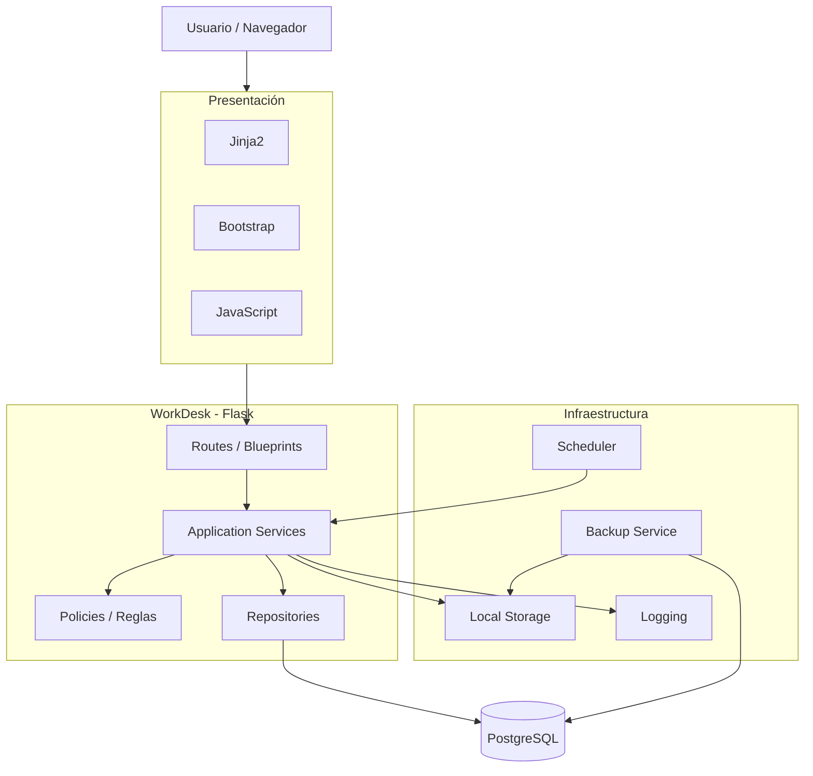
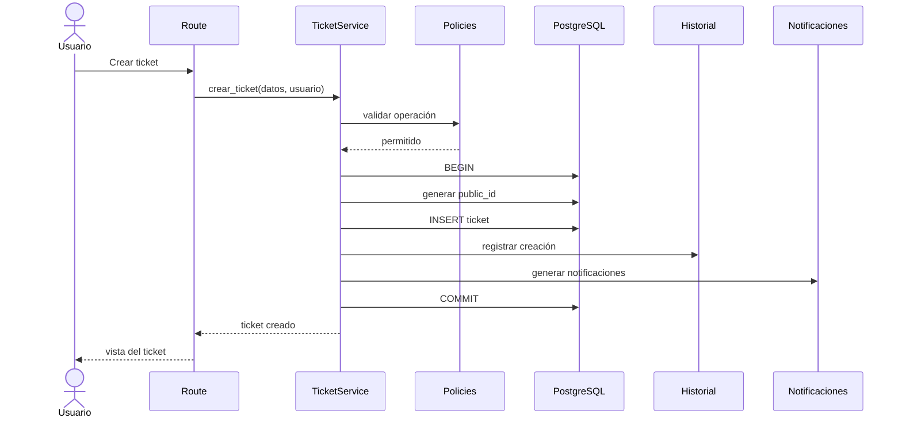
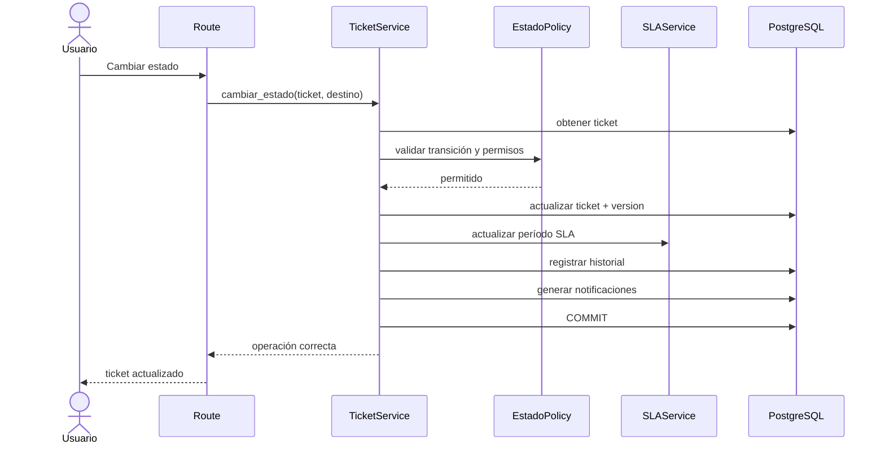
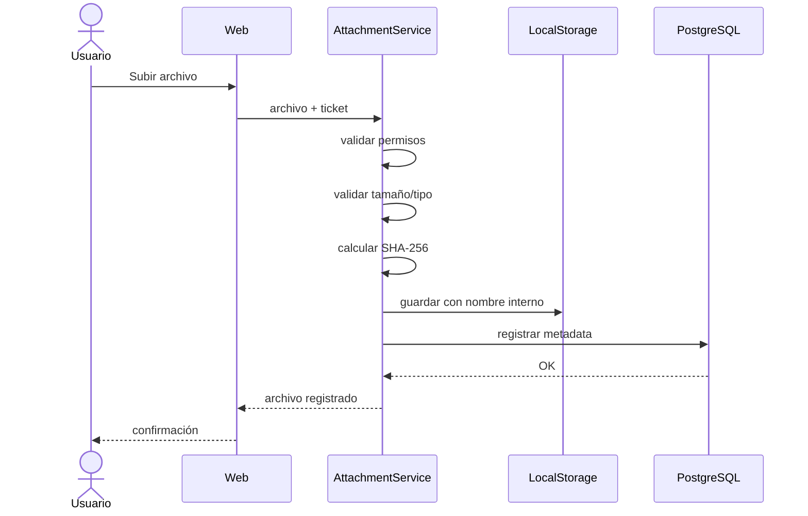

# 10. Arquitectura

## WorkDesk

---

## 1. Información del documento

| Campo | Valor |
| --- | --- |
| Proyecto | WorkDesk |
| Documento | Arquitectura |
| Archivo | `10_arquitectura.md` |
| Versión | 1.1 |
| Estado | Definitivo — actualizado tras `v0.1.0` |
| Alcance | MVP |
| Tipo de arquitectura | Monolito modular en capas |
| Backend | Python + Flask |
| Frontend | HTML + CSS + Bootstrap + JavaScript + Jinja2 |
| Persistencia | PostgreSQL |
| ORM | SQLAlchemy |
| Migraciones | Alembic mediante Flask-Migrate |
| Ejecución inicial | Local |
| Dependencias principales | `01_vision_del_proyecto.md` a `09_modelo_de_datos.md` |

---

# 2. Propósito

El presente documento define la arquitectura técnica del MVP de **WorkDesk**.

Su objetivo es transformar las decisiones funcionales y de datos previamente establecidas en una estructura técnica concreta, mantenible, segura y suficientemente flexible para implementar el sistema.

La arquitectura define principalmente:

- El estilo arquitectónico.
- La organización del código.
- Las responsabilidades de cada capa.
- Los módulos principales de la aplicación.
- Las tecnologías seleccionadas.
- La comunicación entre frontend y backend.
- El acceso a PostgreSQL.
- La gestión de transacciones.
- La estrategia de autenticación y sesiones.
- La autorización basada en roles.
- La protección de formularios y peticiones.
- La estrategia de archivos adjuntos.
- La ejecución de tareas automáticas.
- El cálculo de SLA.
- Las notificaciones internas.
- La concurrencia.
- La generación de identificadores.
- El historial y auditoría.
- Los respaldos y restauraciones.
- El logging.
- El manejo de errores.
- La configuración.
- Los entornos.
- Las pruebas.
- La ejecución local.
- La preparación para evolución futura.

Este documento define **cómo será construido técnicamente WorkDesk**, pero no reemplaza los requisitos funcionales, reglas de negocio, casos de uso, flujo de tickets ni modelo de datos.

## 2.1. Estado de implementación

La arquitectura descrita en este documento representa la **arquitectura objetivo del MVP**.

A partir de `v0.1.0 — Fundación técnica`, algunas decisiones ya se encuentran implementadas y validadas, entre ellas:

- patrón Application Factory;
- configuración mediante variables de entorno;
- PostgreSQL + SQLAlchemy + Flask-SQLAlchemy;
- migraciones mediante Alembic / Flask-Migrate;
- módulos iniciales `auth`, `main`, `models`, `security`, `seeds` y `system`;
- Flask-Login;
- Argon2id;
- CSRF mediante Flask-WTF;
- protección básica de sesión e invalidación mediante `token_version`;
- manejo global de errores;
- health check de aplicación + PostgreSQL;
- logging persistente con rotación;
- suite de pruebas aislada sobre `workdesk_test`;
- Ruff como herramienta de calidad estática.

Las capas, módulos y servicios que todavía no poseen una necesidad concreta se incorporarán progresivamente. La arquitectura objetivo no obliga a crear anticipadamente carpetas o abstracciones vacías.

---

# 3. Fuentes arquitectónicas

La arquitectura se deriva principalmente de:

```text
01_vision_del_proyecto.md
02_objetivos.md
03_roles_y_permisos.md
04_requisitos_funcionales.md
05_requisitos_no_funcionales.md
06_reglas_de_negocio.md
07_casos_de_uso.md
08_flujo_de_tickets.md
09_modelo_de_datos.md
```

La arquitectura no deberá modificar arbitrariamente las decisiones funcionales definidas anteriormente.

Cuando exista una diferencia entre una definición preliminar antigua y una decisión consolidada posteriormente, tendrán precedencia las decisiones más recientes y específicas contenidas principalmente en los documentos `04` a `09`.

En particular, `09_modelo_de_datos.md` constituye la referencia técnica principal para la persistencia.

---

# 4. Objetivos arquitectónicos

La arquitectura de WorkDesk perseguirá los siguientes objetivos.

## 4.1. Mantenibilidad

El código deberá poder comprenderse, modificarse y extenderse sin necesidad de conocer toda la aplicación.

Las responsabilidades deberán mantenerse delimitadas.

## 4.2. Simplicidad proporcional al MVP

La arquitectura deberá ser profesional sin incorporar componentes cuya complejidad no esté justificada.

No se utilizarán tecnologías distribuidas únicamente para aumentar artificialmente la sofisticación técnica del proyecto.

## 4.3. Integridad

Las operaciones deberán preservar la consistencia de los datos incluso ante errores o concurrencia.

PostgreSQL deberá actuar como una última barrera de integridad mediante restricciones, claves foráneas, índices y transacciones.

## 4.4. Trazabilidad

Las operaciones relevantes deberán generar la información histórica definida para WorkDesk.

La arquitectura deberá facilitar y no obstaculizar la creación de historial y auditoría.

## 4.5. Seguridad transversal

La seguridad deberá aplicarse en backend independientemente de la interfaz utilizada.

La ocultación de botones nunca constituirá por sí sola una autorización.

## 4.6. Capacidad de prueba

La lógica importante deberá poder probarse sin depender necesariamente de la interfaz gráfica.

## 4.7. Evolución controlada

La solución deberá poder incorporar posteriormente:

- tareas;
- proyectos;
- activos;
- nuevas comunicaciones;
- API externa;
- almacenamiento externo;
- infraestructura remota;
- multiempresa;
- nuevos procesos automáticos;

sin requerir reescribir completamente el núcleo existente.

---

# 5. Restricciones arquitectónicas del MVP

La arquitectura deberá respetar las siguientes restricciones:

1. WorkDesk será una aplicación web.
2. Python será el lenguaje principal del backend.
3. PostgreSQL será la base de datos.
4. El frontend utilizará principalmente HTML, CSS, Bootstrap y JavaScript.
5. El MVP deberá ejecutarse localmente.
6. No deberá requerir permanentemente conexión a Internet.
7. Los archivos se almacenarán localmente.
8. Las notificaciones serán internas.
9. No será obligatorio utilizar WebSockets.
10. No se utilizará infraestructura distribuida obligatoria.
11. El sistema deberá soportar aproximadamente entre 10 y 20 usuarios concurrentes en su escenario inicial.
12. Los datos deberán conservar trazabilidad.
13. Los archivos deberán permanecer protegidos.
14. La arquitectura deberá favorecer pruebas automatizadas.
15. La complejidad deberá mantenerse proporcional al alcance.

---

# 6. Estilo arquitectónico seleccionado

WorkDesk utilizará un:

> **Monolito modular organizado mediante capas internas.**

Esta será la arquitectura oficial del MVP.

```text
                    WORKDESK
                        │
                        ▼
                Monolito modular
                        │
        ┌───────────────┼───────────────┐
        │               │               │
     Tickets         Usuarios          SLA
        │               │               │
   Notificaciones   Configuración   Conocimiento
        │               │               │
      Reportes       Auditoría        Grupos
```

Todos los módulos formarán parte de una misma aplicación Python y utilizarán inicialmente una misma base de datos PostgreSQL.

---

# 7. Justificación del monolito modular

Un sistema distribuido basado en microservicios no aporta beneficios suficientes para el MVP actual.

Introducir microservicios implicaría incorporar innecesariamente:

- múltiples aplicaciones;
- múltiples despliegues;
- comunicación entre servicios;
- autenticación distribuida;
- observabilidad distribuida;
- tolerancia a fallos de red;
- gestión de múltiples procesos;
- contratos entre servicios;
- mayor complejidad operacional.

El alcance inicial no requiere estas capacidades.

Un monolito modular permite:

- mantener una única aplicación;
- utilizar una única base de datos;
- simplificar el desarrollo;
- mantener transacciones fuertes;
- depurar más fácilmente;
- probar los flujos completos;
- mantener un despliegue simple;
- aprender principios arquitectónicos sin añadir infraestructura artificial.

El término **monolito** no significa que todo el código se encontrará mezclado.

La modularidad interna será obligatoria.

---

# 8. Evolución arquitectónica

La decisión de utilizar un monolito modular no impide que en el futuro ciertos componentes puedan separarse.

```text
MVP
 │
 ▼
Monolito modular
 │
 ├── Tickets
 ├── Usuarios
 ├── SLA
 ├── Notificaciones
 ├── Conocimiento
 └── Reportes
        │
        │ crecimiento real
        ▼
Posible evolución futura
 │
 ├── Aplicación principal
 ├── Servicio de archivos
 ├── Servicio de notificaciones
 ├── API pública
 └── Procesamiento independiente
```

Una separación futura deberá realizarse únicamente cuando exista una necesidad técnica o funcional demostrable.

---

# 9. Framework backend

El framework seleccionado para el MVP será:

> **Flask**

---

# 10. Justificación de Flask

Se consideraron principalmente:

- Flask.
- Django.
- FastAPI.

## 10.1. Flask

Flask proporciona una base web relativamente pequeña y flexible.

Permite comprender claramente:

- rutas;
- peticiones HTTP;
- respuestas;
- sesiones;
- templates;
- extensiones;
- acceso a base de datos;
- middleware;
- servicios;
- organización modular.

Su flexibilidad resulta adecuada para construir explícitamente la arquitectura definida para WorkDesk.

## 10.2. Django

Django constituye una alternativa técnicamente válida y muy completa.

Proporciona de manera integrada:

- ORM;
- autenticación;
- administración;
- formularios;
- sesiones;
- migraciones;
- múltiples herramientas adicionales.

Sin embargo, para WorkDesk introduciría una cantidad mayor de convenciones y funcionalidades integradas de las necesarias para el MVP.

Además, parte del objetivo educativo del proyecto consiste en comprender cómo se organizan los diferentes componentes.

Por ello Django no será utilizado inicialmente.

## 10.3. FastAPI

FastAPI es especialmente adecuado para aplicaciones orientadas principalmente a APIs.

WorkDesk será inicialmente una aplicación web renderizada en servidor y no un backend API destinado a una SPA independiente.

Utilizar FastAPI obligaría a incorporar otras decisiones y componentes adicionales para resolver necesidades que Flask cubre de manera más directa dentro del alcance actual.

## 10.4. Decisión

Para el MVP:

```text
Framework backend = Flask
```

Esta decisión podrá revisarse únicamente si aparece una limitación técnica demostrable.

---

# 11. Patrón Application Factory

WorkDesk utilizará el patrón **Application Factory** de Flask.

La aplicación no deberá crearse globalmente mezclando todas las configuraciones durante la importación.

Se utilizará conceptualmente:

```python
create_app()
```

La fábrica será responsable de:

1. Crear la aplicación Flask.
2. Cargar configuración.
3. Inicializar extensiones.
4. Registrar módulos o Blueprints.
5. Registrar manejadores de errores.
6. Registrar comandos administrativos.
7. Configurar logging.
8. Configurar seguridad transversal.
9. Devolver la instancia lista para ejecución.

Este patrón facilitará especialmente:

- pruebas;
- diferentes configuraciones;
- inicialización controlada;
- futuras variantes de despliegue.

---

# 12. Arquitectura por capas

Cada módulo deberá respetar conceptualmente las siguientes responsabilidades:

```text
┌────────────────────────────┐
│ PRESENTACIÓN               │
│ Routes / Forms / Templates │
└──────────────┬─────────────┘
               │
               ▼
┌────────────────────────────┐
│ APLICACIÓN                 │
│ Services / Use Cases       │
└──────────────┬─────────────┘
               │
               ▼
┌────────────────────────────┐
│ DOMINIO                    │
│ Policies / Rules           │
└──────────────┬─────────────┘
               │
               ▼
┌────────────────────────────┐
│ PERSISTENCIA               │
│ Repositories / ORM         │
└──────────────┬─────────────┘
               │
               ▼
         PostgreSQL
```

---

# 13. Capa de presentación

La presentación será responsable de:

- recibir peticiones HTTP;
- obtener parámetros;
- validar estructura básica de entrada;
- comprobar autenticación inicial;
- invocar servicios;
- transformar resultados en respuestas;
- renderizar templates;
- devolver JSON cuando corresponda;
- gestionar códigos HTTP.

La presentación no deberá implementar reglas complejas del ciclo de tickets.

Ejemplo incorrecto:

```python
@route(...)
def cerrar_ticket():
    # 80 líneas decidiendo estados,
    # permisos, SLA, historial, etc.
```

Ejemplo esperado:

```python
@route(...)
def cerrar_ticket():
    resultado = ticket_service.cerrar(...)
    return ...
```

---

# 14. Capa de aplicación

La capa de aplicación coordinará los casos de uso.

Ejemplos:

```text
crear_ticket()
asignar_tecnico()
cambiar_estado()
resolver_ticket()
cerrar_ticket()
reabrir_ticket()
registrar_comentario()
crear_backup()
```

Esta capa será responsable de:

- coordinar reglas;
- comprobar autorizaciones específicas;
- gestionar transacciones;
- invocar repositorios;
- registrar historial;
- crear notificaciones;
- coordinar archivos;
- devolver resultados.

La transacción deberá pertenecer principalmente al servicio o caso de uso y no al controlador HTTP.

---

# 15. Dominio y políticas

Las reglas que no sean simples operaciones CRUD deberán concentrarse en funciones o componentes de dominio.

Ejemplos:

```text
puede_ver_ticket()
puede_editar_ticket()
puede_cambiar_estado()
transicion_permitida()
puede_cerrar_directamente()
puede_reabrir()
calcular_estado_sla()
```

Las políticas no deberán depender directamente de HTML ni del navegador.

Siempre que resulte razonable tampoco deberán depender de Flask.

Esto facilitará las pruebas unitarias.

---

# 16. Persistencia y repositorios

Los repositorios serán responsables de las operaciones de consulta y persistencia necesarias para los módulos.

Ejemplos:

```text
TicketRepository
UsuarioRepository
GrupoRepository
NotificacionRepository
SLARepository
```

Un repositorio podrá:

- recuperar entidades;
- ejecutar consultas especializadas;
- aplicar filtros;
- cargar relaciones;
- persistir cambios.

Los repositorios **no deberán ejecutar commits arbitrariamente**.

La transacción pertenece al servicio que coordina el caso de uso.

No se construirá un framework genérico de repositorios CRUD si no aporta valor.

Los repositorios serán explícitos y orientados a necesidades reales.

---

# 17. Organización modular

Los principales módulos previstos serán:

```text
auth
users
groups
tickets
sla
notifications
knowledge
reports
audit
admin
```

Cada módulo será responsable de una parte concreta de WorkDesk.

---

# 18. Módulo `auth`

Responsabilidades:

- login;
- logout;
- sesiones;
- cambio de contraseña cuando corresponda;
- intentos fallidos;
- bloqueo temporal;
- eventos de autenticación;
- comprobación de usuario activo.

---

# 19. Módulo `users`

Responsabilidades:

- usuarios;
- roles;
- activación;
- desactivación;
- información del perfil;
- cambios administrativos.

---

# 20. Módulo `groups`

Responsabilidades:

- grupos;
- membresías;
- técnicos asociados;
- historial temporal de pertenencia.

---

# 21. Módulo `tickets`

Será el núcleo funcional.

Contendrá:

- creación;
- consulta;
- clasificación;
- solicitantes;
- técnicos;
- asignación;
- reasignación;
- estados;
- resolución;
- cierre;
- reapertura;
- comentarios;
- notas internas;
- adjuntos;
- relaciones entre tickets;
- historial operativo;
- control de edición.

---

# 22. Módulo `sla`

Responsabilidades:

- políticas SLA;
- calendario laboral;
- períodos SLA;
- pausas;
- excepciones;
- cálculo;
- vencimientos;
- indicadores.

---

# 23. Módulo `notifications`

Responsabilidades:

- generar notificaciones internas;
- consultar notificaciones;
- estado leído/no leído;
- destinatarios;
- reglas configurables.

---

# 24. Módulo `knowledge`

Responsabilidades:

- artículos;
- clasificación;
- visibilidad;
- publicación;
- relación con tickets.

---

# 25. Módulo `reports`

Responsabilidades:

- dashboards;
- consultas agregadas;
- métricas;
- exportación CSV;
- exportación XLSX.

---

# 26. Módulo `audit`

Responsabilidades:

- consulta administrativa del historial;
- auditoría administrativa;
- apoyo transversal al registro de operaciones críticas.

La creación de eventos podrá ser invocada desde otros módulos.

---

# 27. Módulo `admin`

Responsabilidades:

- configuración;
- prioridades;
- categorías;
- ubicaciones;
- estados configurables;
- restricciones de archivos;
- políticas de retención;
- configuración de notificaciones;
- inicialización;
- respaldo;
- diagnóstico.

---

# 28. Estructura actual y evolución objetivo

## 28.1. Estructura implementada en `v0.1.0`

La fundación técnica utiliza actualmente una estructura proporcional al alcance real del proyecto:

```text
WorkDesk/
│
├── docs/
├── instance/
│   ├── backups/
│   ├── logs/
│   └── uploads/
├── migrations/
├── scripts/
├── src/
│   └── workdesk/
│       ├── auth/
│       ├── main/
│       ├── models/
│       ├── security/
│       ├── seeds/
│       ├── static/
│       ├── system/
│       ├── templates/
│       ├── __init__.py
│       ├── cli.py
│       ├── config.py
│       ├── errors.py
│       ├── extensions.py
│       └── logging_config.py
├── tests/
├── .env.example
├── .gitignore
├── requirements.txt
├── requirements-dev.txt
└── README.md
```

Esta estructura no contradice la arquitectura por capas. Las capas de aplicación, dominio y persistencia se materializarán explícitamente cuando la complejidad funcional lo justifique.

## 28.2. Evolución objetivo

La estructura se conservará y evolucionará aproximadamente hacia:

```text
WorkDesk/
│
├── docs/
│   ├── assets/
│   │   ├── diagrams/
│   │   └── images/
│   │
│   ├── 01_vision_del_proyecto.md
│   ├── 02_objetivos.md
│   ├── 03_roles_y_permisos.md
│   ├── 04_requisitos_funcionales.md
│   ├── 05_requisitos_no_funcionales.md
│   ├── 06_reglas_de_negocio.md
│   ├── 07_casos_de_uso.md
│   ├── 08_flujo_de_tickets.md
│   ├── 09_modelo_de_datos.md
│   ├── 10_arquitectura.md
│   ├── 11_diseno_de_pantallas.md
│   └── 12_roadmap.md
│
├── src/
│   └── workdesk/
│       ├── __init__.py
│       ├── config.py
│       ├── extensions.py
│       │
│       ├── common/
│       │   ├── errors.py
│       │   ├── permissions.py
│       │   ├── security.py
│       │   ├── pagination.py
│       │   └── time.py
│       │
│       ├── modules/
│       │   ├── auth/
│       │   │   ├── routes.py
│       │   │   ├── forms.py
│       │   │   ├── services.py
│       │   │   ├── repositories.py
│       │   │   └── models.py
│       │   │
│       │   ├── users/
│       │   ├── groups/
│       │   ├── tickets/
│       │   ├── sla/
│       │   ├── notifications/
│       │   ├── knowledge/
│       │   ├── reports/
│       │   ├── audit/
│       │   └── admin/
│       │
│       ├── infrastructure/
│       │   ├── storage/
│       │   ├── backups/
│       │   ├── scheduler/
│       │   └── logging/
│       │
│       ├── templates/
│       │   ├── layouts/
│       │   ├── components/
│       │   ├── auth/
│       │   ├── tickets/
│       │   ├── users/
│       │   └── admin/
│       │
│       └── static/
│           ├── css/
│           ├── js/
│           ├── img/
│           └── vendor/
│
├── migrations/
│
├── tests/
│   ├── unit/
│   ├── integration/
│   └── functional/
│
├── scripts/
│
├── instance/
│   ├── uploads/
│   ├── backups/
│   └── logs/
│
├── .env.example
├── .gitignore
├── requirements.txt
├── requirements-dev.txt
└── README.md
```

La existencia de esta estructura no obliga a crear desde el primer día carpetas vacías para funcionalidades todavía no implementadas.

Los módulos deberán incorporarse progresivamente.

---

# 29. Directorio `instance`

Los datos generados durante la ejecución se mantendrán separados del código utilizando el directorio local de instancia de Flask.

```text
instance/
├── uploads/
├── backups/
└── logs/
```

El contenido operativo de `instance/` no deberá almacenarse normalmente en Git.

Esta decisión concreta reemplaza la propuesta inicial de utilizar un directorio `var/` y mantiene el mismo principio arquitectónico: separar datos locales de ejecución del código fuente versionado.

---

# 30. Frontend

El frontend del MVP utilizará:

```text
HTML
CSS
Bootstrap
JavaScript
Jinja2
```

La estrategia principal será:

> **Server-Side Rendering + Progressive Enhancement**

El servidor Flask generará las páginas utilizando Jinja2.

JavaScript se utilizará únicamente cuando mejore la interacción.

Ejemplos:

- notificaciones;
- filtros dinámicos;
- confirmaciones;
- bloqueo de edición;
- actualización parcial;
- peticiones asíncronas.

No se construirá una SPA para el MVP.

---

# 31. Bootstrap sin dependencia permanente de Internet

Los recursos necesarios de Bootstrap deberán quedar disponibles localmente dentro de la aplicación.

No deberá existir dependencia obligatoria de CDN para utilizar WorkDesk.

Ejemplo:

```text
static/
└── vendor/
    └── bootstrap/
        ├── css/
        └── js/
```

La misma regla se aplicará a cualquier recurso imprescindible para el funcionamiento básico.

---

# 32. Comunicación HTTP

La comunicación principal seguirá:

```text
Navegador
    │
    │ HTTP Request
    ▼
Flask Route
    │
    ▼
Application Service
    │
    ▼
Repository / PostgreSQL
    │
    ▼
Service
    │
    ▼
Template / JSON
    │
    ▼
Navegador
```

---

# 33. Endpoints HTML y JSON

La interfaz principal utilizará rutas HTML.

Ejemplos conceptuales:

```text
/auth/login
/auth/logout

/tickets
/tickets/nuevo
/tickets/<public_id>

/usuarios
/grupos

/admin/configuracion
/admin/auditoria
/admin/backups
```

También podrán existir endpoints JSON específicos.

Ejemplos:

```text
/api/v1/notifications/unread
/api/v1/tickets/<id>/lock
/api/v1/tickets/<id>/lock/heartbeat
/api/v1/tickets/<id>/lock/release
```

La existencia de estos endpoints internos no implica que WorkDesk disponga todavía de una API pública externa.

---

# 34. Versionado de API

Los endpoints JSON deberán utilizar un prefijo versionado cuando formen una interfaz reusable:

```text
/api/v1/
```

Esto permitirá modificar posteriormente contratos sin afectar necesariamente versiones anteriores.

---

# 35. Persistencia

La persistencia utilizará:

```text
PostgreSQL
    +
SQLAlchemy
```

SQLAlchemy será el ORM principal.

Se utilizará preferentemente la sintaxis y modelo de trabajo moderno de SQLAlchemy.

---

# 36. Integración Flask-SQLAlchemy

Para simplificar la integración con Flask podrá utilizarse:

> `Flask-SQLAlchemy`

La extensión no sustituye SQLAlchemy.

Su finalidad será administrar de manera cómoda:

- engine;
- sesión;
- integración con contexto Flask.

Las consultas y modelos deberán seguir manteniendo una organización explícita.

---

# 37. Driver PostgreSQL

La comunicación con PostgreSQL utilizará:

> `psycopg`

correspondiente a la generación moderna del driver PostgreSQL para Python.

---

# 38. Migraciones

El esquema de la base de datos será gestionado mediante:

> **Alembic**

Para su integración con Flask podrá utilizarse:

> **Flask-Migrate**

Flask-Migrate actuará como integración y Alembic continuará siendo el motor de migraciones.

No deberá utilizarse `create_all()` como estrategia normal para evolucionar el esquema del sistema.

El flujo esperado será:

```text
Modificar modelos
      │
      ▼
Generar migración
      │
      ▼
Revisar migración
      │
      ▼
Aplicar migración
      │
      ▼
Ejecutar pruebas
```

Las migraciones generadas deberán revisarse antes de aplicarse.

---

# 39. Convenciones de persistencia

Se conservarán las decisiones de `09_modelo_de_datos.md`:

- PostgreSQL.
- Tablas y columnas en `snake_case`.
- Claves primarias `BIGINT`.
- Fechas mediante `TIMESTAMPTZ`.
- Integridad referencial.
- Eliminación lógica como mecanismo normal.
- Historial append-only.
- `JSONB` únicamente cuando esté justificado.
- Índices definidos según necesidades reales.
- Relaciones históricas preservadas.

---

# 40. Gestión de transacciones

Un caso de uso que modifica información deberá ejecutarse dentro de una transacción coherente.

Ejemplo:

```text
Cambiar estado
     │
     ├── actualizar ticket
     ├── actualizar SLA
     ├── registrar historial
     └── generar notificación
             │
             ▼
           COMMIT
```

Si ocurre un error antes de completar la operación:

```text
ROLLBACK
```

No deberá quedar un ticket actualizado sin el historial necesario debido a commits intermedios.

Los repositorios no realizarán commits independientes salvo procedimientos expresamente excepcionales.

---

# 41. Nivel de aislamiento

El MVP utilizará inicialmente el nivel normal de PostgreSQL:

> `READ COMMITTED`

Los casos que requieran coordinación adicional utilizarán mecanismos específicos:

- bloqueo de fila;
- restricciones únicas;
- control optimista;
- transacciones explícitas.

No se utilizará un nivel global más restrictivo sin necesidad.

---

# 42. Generación de `public_id`

Los identificadores visibles de tickets no se generarán mediante:

```text
MAX(public_id) + 1
```

Esa estrategia no es segura frente a concurrencia.

Se utilizará una secuencia PostgreSQL dedicada.

Conceptualmente:

```text
ticket_public_id_seq
```

Flujo:

```text
Crear ticket
     │
     ▼
nextval(sequence)
     │
     ▼
convertir a representación textual
     │
     ▼
guardar en public_id
```

La secuencia garantiza que dos creaciones concurrentes no reciban el mismo valor.

Podrán existir saltos en la numeración cuando una transacción se revierta.

Esto es aceptable.

El requisito es correlación y unicidad, no ausencia matemática de saltos.

---

# 43. Estado actual e historial

Se mantendrá el principio:

```text
tickets
    =
estado actual

historial_ticket
    =
secuencia histórica
```

La aplicación no deberá intentar utilizar el historial como sustituto permanente de las columnas actuales del ticket.

Tampoco deberá sobrescribir el historial cuando cambie el estado actual.

---

# 44. Historial append-only

Los siguientes registros serán tratados como históricos:

```text
historial_ticket
auditoria_administrativa
eventos_autenticacion
```

La aplicación ordinaria no proporcionará operaciones CRUD de modificación sobre estas entidades.

Una corrección extraordinaria deberá generar un nuevo evento compensatorio o seguir un procedimiento administrativo específico.

---

# 45. Historial desde la capa de aplicación

El historial será generado principalmente por los servicios que ejecutan los casos de uso.

Ejemplo:

```text
TicketService.cambiar_estado()
        │
        ├── valida transición
        ├── actualiza ticket
        ├── actualiza SLA
        ├── historial.registrar(...)
        └── notificaciones.crear(...)
```

No se trasladará toda la lógica de historial a triggers PostgreSQL.

La lógica en Python será más explícita, mantenible y testeable.

La base de datos continuará protegiendo la integridad estructural.

---

# 46. Autenticación

La autenticación del MVP estará basada en:

```text
username / contraseña
            │
            ▼
         Flask
            │
            ▼
      Usuario PostgreSQL
            │
            ▼
        Sesión web
```

No será necesario OAuth, Active Directory, LDAP ni proveedores externos para el MVP.

---

# 47. Hash de contraseñas

El algoritmo seleccionado será:

> **Argon2id**

Se utilizará mediante una biblioteca especializada, por ejemplo `argon2-cffi`.

Nunca se almacenará la contraseña original.

```text
Contraseña
    │
    ▼
Argon2id
    │
    ▼
password_hash
```

La configuración deberá permitir actualizar progresivamente los parámetros de costo cuando sea necesario.

---

# 48. Flask-Login

Se utilizará:

> `Flask-Login`

para facilitar:

- identificación del usuario autenticado;
- `current_user`;
- protección de rutas;
- login;
- logout;
- carga del usuario.

Flask-Login no determinará por sí solo las autorizaciones del dominio.

---

# 49. Estrategia de sesiones

El MVP utilizará sesiones web firmadas por Flask.

La cookie contendrá únicamente información necesaria de sesión.

No deberán almacenarse:

- contraseñas;
- información sensible del ticket;
- permisos completos;
- datos confidenciales.

Como mínimo la sesión podrá mantener:

```text
usuario
momento_login
ultima_actividad
token_version
```

---

# 50. `token_version`

Cada usuario mantiene:

```text
usuarios.token_version
```

Al crear la sesión se copia la versión vigente.

En cada operación autenticada se compara:

```text
session.token_version
        ==
usuario.token_version
```

Si no coinciden:

```text
sesión inválida
→ logout
→ autenticación requerida
```

El valor podrá incrementarse ante eventos de seguridad como:

- cambio de contraseña;
- invalidación administrativa;
- determinadas modificaciones de seguridad;
- desactivación/reactivación cuando corresponda.

Esto permite invalidar sesiones anteriores sin mantener obligatoriamente una tabla persistente de sesiones.

---

# 51. Duración de sesión

Como valores iniciales:

```text
Inactividad máxima: 30 minutos
Duración total máxima: 8 horas
```

En cada solicitud autenticada se comprobarán ambos límites.

Cuando cualquiera se supere:

```text
sesión inválida
→ usuario debe autenticarse nuevamente
```

Los valores podrán parametrizarse posteriormente.

Estos límites forman parte de la estrategia objetivo de autenticación y todavía no se consideran implementados en `v0.1.0`. Su incorporación corresponde a la evolución de autenticación y RBAC.

---

# 52. Cookies

Las cookies de sesión deberán utilizar como mínimo:

```text
HttpOnly = True
SameSite = Lax
```

Cuando el sistema se ejecute mediante HTTPS:

```text
Secure = True
```

Durante desarrollo local mediante HTTP, `Secure` podrá mantenerse desactivado debido a la naturaleza del entorno.

Una futura instalación productiva deberá utilizar HTTPS.

---

# 53. Protección CSRF

Los formularios y operaciones autenticadas que modifiquen estado estarán protegidos frente a CSRF.

Se utilizará:

> `Flask-WTF / CSRFProtect`

Los formularios HTML incorporarán token CSRF.

Las peticiones JavaScript que modifiquen información deberán enviar igualmente un token válido.

Las operaciones `GET` no deberán modificar información.

---

# 54. Autorización RBAC

El modelo será RBAC:

```text
Usuario
   │
   ▼
  Rol
   │
   ▼
Políticas
```

Roles estructurales:

```text
SOLICITANTE
TECNICO
SUPERVISOR
ADMINISTRADOR
```

No se creará una tabla de permisos dinámica para el MVP.

Las reglas estarán definidas explícitamente por la aplicación.

---

# 55. Políticas de autorización

Se implementarán políticas centralizadas.

Ejemplos:

```text
can_view_ticket()
can_comment_ticket()
can_add_internal_note()
can_assign_ticket()
can_change_priority()
can_manage_users()
can_view_audit()
```

Las rutas deberán utilizar estas políticas antes de ejecutar operaciones.

---

# 56. Seguridad en backend

Una operación no deberá considerarse autorizada únicamente porque un botón no aparezca en pantalla.

```text
Usuario
  │
  ├── botón oculto
  │
  └── intenta URL manualmente
             │
             ▼
         BACKEND
             │
             ▼
     autorización nuevamente
```

El backend siempre tendrá la decisión final.

---

# 57. Separación de comentarios internos

Las consultas deberán filtrar explícitamente los comentarios según visibilidad.

El sistema nunca deberá serializar indiscriminadamente todos los comentarios y confiar posteriormente en JavaScript para ocultar los internos.

La separación se aplicará antes de generar la respuesta.

---

# 58. Prevención de XSS

Jinja2 mantendrá su autoescape habilitado.

Los comentarios y descripciones de usuarios serán tratados como texto.

No se permitirá insertar HTML arbitrario sin un proceso de sanitización específico.

Se evitará utilizar:

```text
|safe
```

sobre contenido introducido por usuarios salvo justificación expresa.

---

# 59. Cabeceras básicas de seguridad

La aplicación deberá incorporar progresivamente cabeceras adecuadas, entre ellas:

```text
X-Content-Type-Options: nosniff
Referrer-Policy
Content-Security-Policy
```

Se evitarán recursos externos innecesarios, facilitando una política de contenido basada principalmente en:

```text
'self'
```

---

# 60. Intentos fallidos de autenticación

El sistema utilizará inicialmente:

```text
Máximo aproximado: 5 intentos
Bloqueo temporal: 15 minutos
```

El proceso utilizará:

```text
intentos_fallidos
bloqueado_hasta
eventos_autenticacion
```

Un login exitoso podrá reiniciar los intentos fallidos de acuerdo con la política definida.

---

# 61. Archivos adjuntos

Los archivos se almacenarán siguiendo:

```text
PostgreSQL
   │
   └── metadatos

Sistema de archivos
   │
   └── contenido binario
```

El contenido del archivo no será almacenado como `BYTEA` dentro de PostgreSQL para el MVP.

---

# 62. Directorio de archivos

Los adjuntos se mantendrán fuera de `static/`.

Ejemplo:

```text
var/
└── uploads/
    ├── 2026/
    │   ├── 01/
    │   ├── 02/
    │   └── ...
```

La organización final podrá dividirse temporalmente para evitar un único directorio con miles de archivos.

---

# 63. Nombre físico de archivo

Nunca se utilizará directamente el nombre original como nombre físico.

Se generará un nombre interno impredecible y único.

Ejemplo conceptual:

```text
UUID
```

El nombre original continuará almacenado en PostgreSQL únicamente como metadata.

Ejemplo:

```text
nombre_original:
captura_error.png

nombre_interno:
f13ae69d23b94e8792a4be64c73d27ab
```

---

# 64. Ruta del archivo

`archivos.ruta_archivo` almacenará una ruta relativa controlada por WorkDesk.

No se almacenará como URL pública.

El backend resolverá la ruta desde el directorio raíz configurado.

Los parámetros entregados por el usuario nunca deberán convertirse directamente en rutas del sistema.

---

# 65. Validación de archivos

Antes de aceptar un archivo se validará:

- tamaño;
- cantidad;
- extensión permitida;
- tipo MIME;
- configuración vigente.

No se confiará exclusivamente en el nombre indicado por el usuario.

Los archivos rechazados no deberán quedar disponibles.

---

# 66. SHA-256

Durante el almacenamiento del archivo se calculará:

> **SHA-256**

El cálculo se realizará por bloques para evitar cargar archivos grandes completos en memoria.

El resultado se almacenará como representación hexadecimal en minúsculas.

El hash permitirá verificar integridad.

No constituirá automáticamente un mecanismo de deduplicación.

---

# 67. Flujo seguro de subida

La operación seguirá aproximadamente:

```text
Usuario
   │
   ▼
Archivo temporal
   │
   ├── validar tamaño
   ├── validar tipo
   └── calcular SHA-256
          │
          ▼
   generar nombre interno
          │
          ▼
      mover archivo
          │
          ▼
   registrar metadata BD
```

Si la persistencia en base de datos falla después de mover el archivo, la aplicación intentará eliminar compensatoriamente el archivo físico.

Los archivos huérfanos detectados deberán registrarse para diagnóstico.

---

# 68. Descarga de archivos

Los archivos nunca se expondrán directamente mediante:

```text
/static/uploads/...
```

El flujo será:

```text
GET archivo
    │
    ▼
buscar metadata
    │
    ▼
obtener ticket
    │
    ▼
comprobar autorización
    │
    ▼
resolver ruta interna
    │
    ▼
enviar archivo
```

El nombre original podrá utilizarse únicamente como nombre sugerido durante la descarga.

---

# 69. Eliminación de archivos

La eliminación normal será lógica.

```text
activo = FALSE
fecha_eliminacion
usuario_eliminacion_id
```

Esto no implicará inmediatamente la eliminación del archivo físico.

El archivo físico podrá eliminarse posteriormente mediante una política de retención habilitada explícitamente.

---

# 70. Concurrencia

WorkDesk utilizará dos barreras complementarias:

```text
1. Bloqueo lógico temporal
2. Control optimista mediante version
```

---

# 71. Bloqueo lógico de edición

Cuando un usuario entre en modo edición sobre un ticket, el frontend solicitará un bloqueo.

```text
Usuario A
    │
    ▼
Acquire lock
    │
    ▼
Ticket bloqueado temporalmente
```

Otro usuario podrá consultar el ticket pero no iniciar normalmente una edición incompatible mientras exista el bloqueo.

---

# 72. Tiempo inicial del bloqueo

Como configuración inicial se utilizará aproximadamente:

```text
TTL bloqueo: 120 segundos
Heartbeat: 45 segundos
```

Mientras el usuario permanezca editando, JavaScript renovará periódicamente el bloqueo.

Estos valores deberán mantenerse configurables.

---

# 73. Liberación

El bloqueo deberá liberarse:

- al guardar;
- al cancelar edición;
- cuando la aplicación determine que finalizó la edición.

Si el navegador se cierra inesperadamente, el bloqueo expirará automáticamente.

---

# 74. Adquisición transaccional de bloqueo

La adquisición seguirá una operación transaccional.

Conceptualmente:

```text
BEGIN

1. bloquear/consultar ticket
2. localizar bloqueo no liberado
3. normalizar bloqueo expirado
4. comprobar disponibilidad
5. crear nuevo bloqueo

COMMIT
```

La restricción única impedirá mantener dos bloqueos no liberados para el mismo ticket.

---

# 75. Control optimista

El bloqueo visual no será suficiente para proteger la integridad.

Cada ticket utilizará:

```text
version
```

Cuando un usuario lee:

```text
version = 8
```

al intentar guardar el backend exige que siga siendo `8`.

Si otro proceso ya actualizó el ticket:

```text
version = 9
```

la operación se rechazará como conflicto.

---

# 76. SQLAlchemy y versión optimista

Cuando resulte conveniente se utilizará el soporte de versionado de SQLAlchemy asociado a:

```text
tickets.version
```

Una actualización exitosa incrementará:

```text
8 → 9
```

Una actualización basada en una versión antigua producirá un conflicto controlado.

---

# 77. Respuesta ante conflicto

La interfaz deberá informar al usuario que el ticket fue modificado por otra persona.

No deberá sobrescribir silenciosamente los cambios.

Conceptualmente:

```text
409 Conflict
```

La interfaz podrá solicitar recargar la información antes de continuar.

---

# 78. SLA

El cálculo de SLA estará implementado mediante un servicio específico.

```text
SLAService
```

El cálculo no deberá distribuirse arbitrariamente entre rutas, templates y consultas.

---

# 79. Tiempo y zona horaria

Los instantes se almacenarán utilizando UTC.

La zona inicial de negocio será:

```text
America/Santiago
```

Python utilizará `zoneinfo` para conversiones.

Las fechas mostradas al usuario serán convertidas a la zona correspondiente.

---

# 80. Cálculo de SLA

El cálculo deberá considerar:

- política aplicada;
- prioridad;
- fecha de inicio;
- horario laboral;
- días hábiles;
- feriados;
- períodos en espera;
- pausas;
- excepciones.

Los períodos históricos permanecerán persistidos según `09_modelo_de_datos.md`.

---

# 81. Snapshot de SLA

Cuando las condiciones aplicables cambien, no deberá reescribirse arbitrariamente el SLA histórico.

El período anterior se cerrará y se creará uno nuevo cuando corresponda.

Esto permite reconstruir las condiciones aplicadas al ticket durante su vida.

---

# 82. Evaluación del SLA

El estado podrá calcularse como:

```text
DENTRO
PROXIMO_A_VENCER
VENCIDO
```

Las denominaciones visibles podrán ajustarse en interfaz.

El SLA será informativo y no bloqueará el trabajo.

---

# 83. Procesos automáticos

Algunas operaciones no dependen directamente de una petición HTTP.

Ejemplos:

- cierre automático;
- comprobación de vencimientos SLA;
- notificaciones temporales;
- limpieza de bloqueos expirados;
- políticas de retención;
- respaldos programados cuando se habiliten.

Estas operaciones no deberán implementarse mediante JavaScript del navegador.

---

# 84. Scheduler

Para el MVP se utilizará un programador de tareas liviano basado en:

> **APScheduler**

No se utilizará Celery para el MVP.

Tampoco se requerirán:

- Redis;
- RabbitMQ;
- Kafka.

---

# 85. Scheduler separado del proceso web

Las tareas programadas deberán ejecutarse preferentemente mediante un proceso separado utilizando el mismo código del monolito.

```text
                   WorkDesk
                      │
        ┌─────────────┴─────────────┐
        │                           │
        ▼                           ▼
   Web Process                Scheduler Process
     Flask                       APScheduler
        │                           │
        └─────────────┬─────────────┘
                      ▼
                 PostgreSQL
```

Esto evita depender de un hilo iniciado accidentalmente varias veces por el servidor web.

Ambos procesos forman parte del mismo sistema y del mismo repositorio.

No convierten la solución en microservicios.

---

# 86. Idempotencia de tareas

Las tareas programadas deberán poder ejecutarse repetidamente sin producir resultados duplicados incorrectos.

Ejemplo:

```text
buscar ticket Resuelto vencido
        │
        ▼
abrir transacción
        │
        ▼
volver a comprobar estado
        │
        ├── ya cerrado → no hacer nada
        │
        └── sigue válido → cerrar
```

Una tarea no deberá confiar exclusivamente en información obtenida antes de iniciar su transacción.

---

# 87. Cierre automático

El proceso programado buscará tickets:

```text
estado = RESUELTO
```

cuya fecha límite de validación haya finalizado.

Antes de cerrar deberá comprobar nuevamente:

- estado actual;
- configuración;
- validaciones;
- período;
- solicitantes cuando corresponda.

El cierre se realizará mediante el mismo servicio de aplicación utilizado por otras operaciones, identificando al actor como Sistema.

---

# 88. Notificaciones internas

Las notificaciones asociadas directamente a una operación del usuario deberán crearse preferentemente dentro de la misma transacción funcional.

Ejemplo:

```text
Reabrir ticket
    │
    ├── cambia estado
    ├── registra historial
    └── crea notificación
```

Las alertas dependientes del tiempo serán generadas por el scheduler.

---

# 89. Actualización de notificaciones

El MVP no utilizará WebSockets.

El navegador podrá consultar periódicamente:

```text
/api/v1/notifications/unread
```

Como referencia inicial podrá realizarse polling cada:

```text
30 segundos
```

También se actualizarán las notificaciones al navegar normalmente entre páginas.

---

# 90. Búsqueda

La búsqueda inicial utilizará capacidades de PostgreSQL.

Se distinguirán:

## 90.1. Identificador

Búsqueda exacta por:

```text
public_id
```

## 90.2. Filtros estructurados

- estado;
- prioridad;
- grupo;
- categoría;
- técnico;
- solicitante;
- fechas;
- SLA.

## 90.3. Texto

Inicialmente podrán utilizarse búsquedas razonables mediante `ILIKE` sobre campos seleccionados.

No se incorporará un motor externo de búsqueda.

---

# 91. Full Text Search futura

Cuando el volumen de datos y las mediciones lo justifiquen podrá utilizarse:

```text
PostgreSQL Full Text Search
+
índice GIN
```

No se utilizarán inicialmente motores como Elasticsearch únicamente para implementar búsqueda de tickets.

---

# 92. Detección básica de duplicados

La advertencia de posibles duplicados podrá reutilizar mecanismos de búsqueda textual y coincidencias simples.

No se requiere Machine Learning para el MVP.

La advertencia nunca reemplazará la decisión del usuario autorizado.

---

# 93. Paginación

Las consultas que puedan devolver una cantidad creciente de registros deberán utilizar paginación.

Ejemplos:

- tickets;
- usuarios;
- auditoría;
- historial;
- artículos;
- notificaciones;
- reportes detallados.

No se cargarán miles de registros únicamente para paginarlos posteriormente en JavaScript.

La paginación deberá realizarse en backend/PostgreSQL.

---

# 94. Evitar consultas N+1

Las relaciones utilizadas en listados deberán cargarse de forma deliberada.

SQLAlchemy podrá utilizar estrategias como:

```text
joinedload
selectinload
```

cuando las mediciones o consultas lo requieran.

La selección deberá hacerse según el tipo de relación y consulta.

---

# 95. Reportes

Los reportes utilizarán consultas específicas y no necesariamente los mismos objetos utilizados por las pantallas CRUD.

Para CSV se utilizarán capacidades estándar de Python.

Para XLSX podrá utilizarse:

> `openpyxl`

La exportación deberá respetar los mismos permisos y filtros que la consulta visible.

---

# 96. Logging

Se utilizará el módulo estándar:

```text
logging
```

de Python.

Los logs técnicos se mantendrán fuera de las tablas funcionales.

---

# 97. Niveles de logging

Se utilizarán:

```text
DEBUG
INFO
WARNING
ERROR
CRITICAL
```

`DEBUG` deberá limitarse principalmente al entorno de desarrollo.

---

# 98. Archivo de logs

La implementación inicial utiliza:

```text
instance/logs/workdesk.log
```

La rotación se realiza mediante `RotatingFileHandler` del módulo estándar `logging`.

Como configuración predeterminada de `v0.1.0`:

```text
tamaño máximo por archivo: 5 MB
backups conservados: 5
```

Los valores son configurables mediante:

```text
LOG_LEVEL
LOG_MAX_BYTES
LOG_BACKUP_COUNT
```

Una estrategia temporal diferente podrá adoptarse posteriormente si aparece una necesidad operacional que la justifique.

---

# 99. Contexto de logging

Cuando corresponda podrá registrarse:

- fecha;
- nivel;
- módulo;
- usuario;
- request ID;
- endpoint;
- operación;
- tiempo;
- excepción.

No deberán registrarse:

- contraseñas;
- hashes completos cuando no sean necesarios;
- tokens;
- cookies;
- secretos;
- contenidos sensibles completos.

---

# 100. Request ID

Cada petición podrá recibir un identificador técnico.

Ejemplo:

```text
request_id
```

Ante un error, este identificador permitirá relacionar:

```text
mensaje al usuario
        ↕
log técnico
```

sin mostrar stack traces.

---

# 101. Manejo de errores

Se utilizarán errores controlados.

Ejemplos:

```text
ValidationError
AuthorizationError
NotFoundError
BusinessRuleError
ConcurrencyError
StorageError
```

Las capas inferiores no deberán construir páginas HTML de error.

---

# 102. Respuestas de error

Ejemplos de códigos HTTP:

```text
400 Bad Request
401 Unauthorized
403 Forbidden
404 Not Found
409 Conflict
413 Payload Too Large
500 Internal Server Error
```

El usuario recibirá mensajes comprensibles.

Los detalles técnicos quedarán en logs.

---

# 103. Manejo transaccional ante error

Ante una excepción dentro de una operación de escritura:

```text
ROLLBACK
```

deberá ejecutarse antes de reutilizar la sesión.

No se continuará trabajando con una transacción fallida.

---

# 104. Health Check

Desde `v0.1.0` se proporciona:

```text
GET /health
```

El endpoint comprueba:

```text
aplicación Flask
+
PostgreSQL
```

Cuando ambos componentes responden devuelve estado `200`. Si PostgreSQL no está disponible, devuelve `503 Service Unavailable` con una respuesta pública mínima y registra el detalle técnico en logs.

En una evolución posterior podrán diferenciarse endpoints como:

```text
/health/live
/health/ready
```

si la topología de ejecución requiere separar liveness y readiness.

---

# 105. Configuración

La configuración técnica no se mezclará con el código.

Se utilizarán:

- clases/configuraciones por entorno;
- variables de entorno;
- configuración funcional en PostgreSQL cuando corresponda.

---

# 106. Variables de entorno

La configuración técnica utilizada desde `v0.1.0` contempla:

```text
APP_ENV
APP_TIMEZONE
SECRET_KEY
SESSION_COOKIE_SECURE
DATABASE_URL
TEST_DATABASE_URL
LOGIN_MAX_FAILED_ATTEMPTS
LOGIN_LOCK_MINUTES
LOG_LEVEL
LOG_MAX_BYTES
LOG_BACKUP_COUNT
```

Variables adicionales como raíces de uploads o backups podrán incorporarse cuando dichos módulos sean implementados.

Los secretos reales no deberán almacenarse en Git.

---

# 107. Archivo `.env`

Durante desarrollo podrá utilizarse:

```text
.env
```

El archivo real deberá quedar excluido mediante `.gitignore`.

El repositorio podrá contener:

```text
.env.example
```

sin credenciales reales.

---

# 108. Entornos

Se definirán conceptualmente:

```text
development
testing
production
```

## 108.1. Development

- depuración habilitada cuando corresponda;
- logs detallados;
- datos ficticios.

## 108.2. Testing

- base de datos de pruebas;
- configuración aislada;
- ejecución automatizada.

## 108.3. Production

Reservado para futuras instalaciones reales.

- depuración desactivada;
- secretos externos;
- HTTPS;
- logging adecuado;
- configuración endurecida.

---

# 109. Bootstrap e inicialización

La inicialización se implementará mediante comandos administrativos explícitos e idempotentes cuando corresponda.

Desde `v0.1.0` existen:

```text
python -m flask --app src.workdesk seed-roles
python -m flask --app src.workdesk create-admin
```

`seed-roles` crea los roles estructurales iniciales de forma idempotente.

`create-admin` permite crear el Administrador inicial mediante un flujo controlado y validado.

A medida que se incorporen estados, prioridades, categorías y configuración esencial podrán añadirse comandos adicionales o consolidarse la inicialización en un comando superior si aporta valor real.

No se creará anticipadamente un comando genérico de inicialización que oculte pasos todavía no implementados.

---

# 110. Datos de demostración

Existirá un mecanismo separado.

Conceptualmente:

```text
flask workdesk seed-demo
```

Este comando generará únicamente información ficticia.

No deberá ejecutarse accidentalmente en un entorno productivo.

---

# 111. Backups

Los respaldos incluirán:

```text
PostgreSQL
+
archivos adjuntos
```

La base de datos se respaldará utilizando herramientas oficiales de PostgreSQL.

Preferentemente:

```text
pg_dump
```

---

# 112. Formato de backup

El backup podrá empaquetarse como un archivo que contenga conceptualmente:

```text
backup/
├── database.dump
├── uploads/
└── manifest.json
```

El manifiesto podrá registrar:

- versión WorkDesk;
- fecha;
- revisión de migración;
- tamaño;
- archivos;
- hashes relevantes.

Finalmente podrá comprimirse como un único archivo.

---

# 113. Integridad del backup

Se calculará SHA-256 sobre el paquete final.

El valor será almacenado en:

```text
historial_backups.hash
```

Antes de restaurar se comprobará el hash.

---

# 114. Consistencia durante backup

Para evitar que la base de datos y los archivos correspondan a momentos incompatibles, una generación consistente deberá impedir temporalmente operaciones de escritura relevantes.

Podrá utilizarse un **modo de mantenimiento** breve mientras se produce la copia consistente.

Durante este período podrán mantenerse consultas cuando técnicamente sea seguro.

---

# 115. Restauración

La restauración se considerará una operación administrativa de alto impacto.

No se realizará como un CRUD normal mientras múltiples usuarios modifican el sistema.

El procedimiento recomendado será:

```text
1. entrar en mantenimiento
2. detener escrituras
3. comprobar backup
4. detener proceso web/scheduler cuando corresponda
5. restaurar PostgreSQL
6. restaurar archivos
7. verificar consistencia
8. iniciar aplicación
9. ejecutar health check
10. registrar resultado
```

La restauración podrá implementarse mediante un comando administrativo/CLI para mantener el procedimiento controlado.

---

# 116. Registro de backups

Cada ejecución deberá utilizar:

```text
historial_backups
```

Estados:

```text
EN_PROGRESO
EXITOSO
FALLIDO
```

Una vez finalizado el backup, su registro se tratará como histórico.

---

# 117. Retención

Las tareas de retención deberán ejecutarse únicamente cuando exista una política habilitada.

El comportamiento predeterminado será:

```text
MANTENER
```

No deberán ejecutarse eliminaciones automáticas destructivas basadas en una configuración inexistente.

---

# 118. Eliminación física mediante retención

Antes de eliminar físicamente un elemento deberá verificarse:

- política activa;
- antigüedad;
- referencias;
- integridad;
- trazabilidad;
- autorización del proceso.

No se deshabilitarán claves foráneas para forzar eliminaciones.

---

# 119. Servidor web local

Durante desarrollo podrá utilizarse el servidor de Flask.

Este servidor será únicamente para desarrollo.

Para demostraciones locales más próximas a una ejecución real se recomienda:

> **Waitress**

Waitress funciona adecuadamente en entornos Windows y permite ejecutar la aplicación WSGI sin depender del servidor de desarrollo.

---

# 120. Topología inicial

La ejecución local podrá representarse así:

```text
┌──────────────────┐
│    Navegador     │
└────────┬─────────┘
         │ HTTP
         ▼
┌──────────────────┐
│ Flask / Waitress │
│    WorkDesk      │
└────────┬─────────┘
         │
         ├─────────────────────┐
         │                     │
         ▼                     ▼
┌──────────────────┐   ┌──────────────────┐
│   PostgreSQL     │   │ Almacenamiento   │
│                  │   │ local            │
└──────────────────┘   │ uploads / logs   │
                       └──────────────────┘

         ┌──────────────────┐
         │ Scheduler        │
         │ APScheduler      │
         └────────┬─────────┘
                  │
                  ▼
             PostgreSQL
```

---

# 121. Docker

Docker no será obligatorio para comenzar el MVP.

La primera implementación podrá utilizar:

```text
Python virtual environment
+
PostgreSQL local
```

La incorporación posterior de Docker y Docker Compose podrá evaluarse para mejorar reproducibilidad o despliegue.

Evitar Docker inicialmente reduce complejidad adicional durante las primeras etapas de aprendizaje e implementación.

---

# 122. Dependencias principales

## 122.1. Dependencias incorporadas en `v0.1.0`

```text
Flask
Flask-SQLAlchemy
Flask-Migrate
Flask-Login
Flask-WTF
SQLAlchemy
Alembic
psycopg
argon2-cffi
python-dotenv
```

Para desarrollo y pruebas:

```text
pytest
ruff
```

## 122.2. Dependencias previstas para fases posteriores

Podrán incorporarse cuando la funcionalidad correspondiente sea implementada:

```text
APScheduler
openpyxl
Waitress
```

No deberán instalarse anticipadamente únicamente porque aparezcan en la arquitectura objetivo.

---

# 123. Gestión de dependencias

Durante la implementación inicial se utilizarán:

```text
requirements.txt
requirements-dev.txt
```

`requirements.txt` contendrá dependencias necesarias para ejecutar WorkDesk.

`requirements-dev.txt` incluirá las dependencias de ejecución y las herramientas adicionales de desarrollo y testing.

Las versiones deberán mantenerse reflejadas en estos archivos cuando se agregue o actualice una dependencia.

La adopción futura de `pyproject.toml` podrá evaluarse si aporta una mejora concreta al empaquetado, tooling o mantenimiento del proyecto.

---

# 124. Calidad del código

Se utilizará:

> **Ruff**

para apoyar:

- linting;
- formato;
- detección de determinados problemas comunes.

La herramienta complementará, pero no sustituirá, la revisión lógica del código.

---

# 125. Convenciones Python

Se mantendrán:

- nombres descriptivos;
- funciones pequeñas cuando sea razonable;
- type hints en interfaces relevantes;
- ausencia de duplicación innecesaria;
- separación de responsabilidades;
- imports organizados;
- excepciones explícitas.

---

# 126. Nomenclatura

La base de datos mantendrá la nomenclatura española definida en `09_modelo_de_datos.md`.

Las entidades de dominio podrán mantener términos coherentes con dicha documentación:

```text
Ticket
Usuario
Prioridad
Categoria
Grupo
```

Los elementos de infraestructura utilizarán convenciones habituales del ecosistema Python cuando corresponda:

```text
create_app
config
extensions
services
repositories
```

La prioridad será mantener consistencia y comprensión, no traducir artificialmente cada término.

---

# 127. Pruebas

Las pruebas utilizarán principalmente:

> `pytest`

En `v0.1.0` la suite se mantiene deliberadamente simple dentro de `tests/`:

```text
tests/
├── conftest.py
├── test_app.py
├── test_auth.py
├── test_passwords.py
└── test_system.py
```

La suite inicial contiene 20 tests automatizados sobre la fundación técnica, autenticación, seguridad, health check y errores.

A medida que aumente el volumen de pruebas podrá evolucionar hacia una organización explícita por tipos:

```text
unit
integration
functional
```

sin crear carpetas vacías antes de que sean necesarias.

---

# 128. Pruebas unitarias

Evaluarán especialmente:

- reglas de estados;
- permisos;
- SLA;
- cierres;
- reaperturas;
- validaciones;
- cálculos;
- políticas.

Intentarán evitar dependencias externas cuando sea posible.

---

# 129. Pruebas de integración

Evaluarán:

- PostgreSQL;
- repositorios;
- transacciones;
- migraciones;
- restricciones;
- archivos;
- servicios coordinados.

Se utilizará una base de datos específica para pruebas.

---

# 130. Pruebas funcionales

Utilizarán el cliente de pruebas de Flask para comprobar flujos HTTP.

Como mínimo deberán cubrir:

- login;
- logout;
- permisos;
- creación de ticket;
- asignación;
- cambio de estado;
- resolución;
- cierre;
- reapertura;
- comentarios;
- adjuntos;
- búsqueda;
- notificaciones.

---

# 131. End-to-end

Las pruebas de navegador completas no serán obligatorias desde el primer incremento.

Podrán incorporarse posteriormente mediante una herramienta como Playwright para los recorridos críticos.

---

# 132. Base de datos de pruebas

Las pruebas no deberán ejecutarse contra la base de datos de desarrollo.

Desde `v0.1.0` se utilizan bases separadas:

```text
workdesk_dev   → desarrollo
workdesk_test  → pytest
```

La configuración de tests valida explícitamente que `TEST_DATABASE_URL` apunte a `workdesk_test` antes de ejecutar operaciones destructivas como `drop_all()`.

Esta protección reduce el riesgo de borrar accidentalmente el esquema de desarrollo durante una ejecución de pruebas.

---

# 133. Datos ficticios

Todas las pruebas y demostraciones utilizarán información ficticia.

No se introducirán datos reales de organizaciones o usuarios como requisito de desarrollo.

---

# 134. Rendimiento

Para el MVP se priorizará:

- consultas paginadas;
- índices adecuados;
- evitar N+1;
- evitar consultas repetidas;
- cargar únicamente información necesaria;
- medir antes de optimizar prematuramente.

---

# 135. Connection Pool

SQLAlchemy administrará un pool de conexiones a PostgreSQL.

No se creará una nueva conexión manual en cada función.

Podrá utilizarse:

```text
pool_pre_ping
```

para detectar conexiones inválidas cuando resulte conveniente.

La configuración exacta del pool deberá ajustarse mediante pruebas antes de incrementar arbitrariamente sus valores.

---

# 136. Caché

No se incorporará Redis ni una caché distribuida en el MVP.

Podrán aplicarse:

- cache de navegador para recursos estáticos;
- optimización de consultas;
- precarga selectiva.

Una capa de cache adicional deberá justificarse mediante medición.

---

# 137. Métricas operativas

Los dashboards obtendrán sus datos desde PostgreSQL mediante consultas específicas.

No se implementará inicialmente una plataforma externa de métricas.

Cuando una consulta agregada resulte costosa podrá optimizarse posteriormente mediante:

- mejores índices;
- consultas específicas;
- vistas;
- vistas materializadas;

si las mediciones lo justifican.

---

# 138. Observabilidad inicial

El MVP contará con:

```text
Logging
+
Health checks
+
Auditoría
+
Historial
```

Cada mecanismo posee una finalidad diferente.

```text
Logging
→ diagnóstico técnico

Historial
→ evolución funcional de ticket

Auditoría
→ acciones administrativas

Eventos autenticación
→ seguridad de acceso
```

No deberán mezclarse indiscriminadamente.

---

# 139. Dependencias entre módulos

Los módulos no deberán modificar directamente las tablas de otro módulo saltándose sus servicios cuando la operación implique reglas de negocio.

Ejemplo incorrecto:

```text
Notifications
    │
    └── actualiza estado ticket directamente
```

Ejemplo esperado:

```text
Notifications
    │
    └── invoca TicketService cuando realmente
        se requiere una operación de tickets
```

Para consultas simples podrán compartirse repositorios o query services cuando esté justificado.

---

# 140. Eventos internos

No se implementará un broker de eventos externo.

Cuando una operación requiera desencadenar efectos internos podrá utilizarse una coordinación explícita desde la capa de aplicación.

Ejemplo:

```text
resolver_ticket()
    │
    ├── ticket
    ├── historial
    ├── SLA
    └── notificaciones
```

Esto favorece claridad y transacciones consistentes.

Un sistema formal de eventos podrá incorporarse posteriormente si aparece suficiente complejidad.

---

# 141. Separación entre comandos y consultas

No se aplicará CQRS completo al MVP.

Sin embargo, conceptualmente se diferenciarán:

```text
Comandos
→ modifican estado

Consultas
→ recuperan información
```

Los reportes y dashboards podrán utilizar query services especializados sin obligar a pasar por objetos diseñados para edición.

---

# 142. Seguridad de la configuración

Valores como:

```text
SECRET_KEY
DATABASE_URL
```

no deberán estar dentro del repositorio con credenciales reales.

Las contraseñas de PostgreSQL tampoco deberán encontrarse hardcodeadas en Python.

---

# 143. Seguridad del almacenamiento

Las carpetas:

```text
instance/uploads
instance/backups
instance/logs
```

no deberán formar parte de las rutas estáticas servidas directamente por Flask.

Los backups deberán encontrarse separados de los adjuntos.

---

# 144. Principio de mínimo privilegio en archivos

Una autorización para ver un ticket no deberá asumirse automáticamente en componentes genéricos sin consultar la política vigente.

La descarga siempre se realizará dentro del contexto del recurso asociado.

---

# 145. Eliminación administrativa

Las operaciones destructivas deberán ejecutarse mediante servicios específicos.

No se implementarán endpoints genéricos capaces de eliminar arbitrariamente entidades del sistema.

Las restricciones funcionales y de integridad deberán evaluarse según el tipo de recurso.

---

# 146. Preparación para multiempresa

El MVP no incorporará:

```text
organizacion_id
tenant_id
```

en todas las tablas anticipadamente.

Esto aumentaría la complejidad sin una necesidad operativa actual.

La modularidad y separación del acceso a datos deberán permitir que una futura evolución multiempresa introduzca dicho concepto mediante una migración controlada.

No se diseñará una falsa arquitectura multi-tenant antes de que exista el requisito.

---

# 147. Preparación para API externa

Los casos de uso importantes permanecerán en servicios independientes de las rutas HTML.

Esto permitirá que en el futuro:

```text
HTML Route
     │
     ▼
TicketService

API Route
     │
     ▼
TicketService
```

ambas interfaces reutilicen la misma lógica.

Esta separación evita tener que reescribir el dominio para incorporar una API futura.

---

# 148. Preparación para almacenamiento externo

El acceso a archivos deberá realizarse mediante un servicio de almacenamiento.

Conceptualmente:

```text
StorageService
```

El MVP tendrá una implementación:

```text
LocalStorage
```

En el futuro podría existir:

```text
S3Storage
AzureBlobStorage
otro almacenamiento
```

sin modificar el comportamiento funcional del ticket.

No es necesario implementar esas alternativas durante el MVP.

---

# 149. Preparación para nuevas comunicaciones

Las notificaciones utilizarán un servicio propio.

Actualmente:

```text
InternalNotificationService
```

Posteriormente podrían añadirse:

```text
EmailNotificationService
PushNotificationService
WebhookNotificationService
```

sin modificar el núcleo del ticket.

---

# 150. Decisiones expresamente descartadas para el MVP

No se utilizarán como componentes obligatorios:

- microservicios;
- Kubernetes;
- Redis;
- Kafka;
- RabbitMQ;
- Celery;
- Elasticsearch;
- React;
- Angular;
- Vue;
- SPA completa;
- WebSockets;
- OAuth externo;
- LDAP;
- Active Directory;
- almacenamiento cloud;
- arquitectura serverless;
- multi-tenant operativo;
- Docker obligatorio;
- API Gateway;
- balanceador de carga;
- infraestructura de alta disponibilidad.

La exclusión no implica que sean tecnologías incorrectas.

Simplemente no existe actualmente una necesidad suficiente que justifique su complejidad.

---

# 151. Diagrama general de arquitectura



---

# 152. Flujo arquitectónico de creación de ticket



---

# 153. Flujo arquitectónico de cambio de estado



---

# 154. Flujo arquitectónico de archivo adjunto



---

# 155. Flujo del scheduler

```mermaid
flowchart TD

    TIMER[APScheduler]
       |
       v
    QUERY[Buscar trabajo pendiente]
       |
       +--> SLA[Revisar SLA]
       |
       +--> CLOSE[Cierres automáticos]
       |
       +--> LOCKS[Normalizar bloqueos]
       |
       +--> RETENTION[Retención habilitada]
       |
       v
    SERVICES[Application Services]
       |
       v
    DB[(PostgreSQL)]
```

---

# 156. Principios de implementación

Durante el desarrollo deberán mantenerse las siguientes reglas:

1. Las rutas deben ser pequeñas.
2. La lógica de negocio no deberá estar en templates.
3. Los repositorios no deberán determinar permisos.
4. Los templates no constituyen seguridad.
5. Los servicios coordinan casos de uso.
6. Las operaciones relacionadas deberán compartir transacción.
7. El historial no se sobrescribe.
8. Los archivos no se sirven públicamente.
9. Las configuraciones sensibles permanecen fuera del código.
10. Las optimizaciones deberán justificarse mediante necesidad o medición.
11. La estructura modular deberá respetarse incluso dentro del monolito.
12. No se introducirán tecnologías distribuidas anticipadamente.

---

# 157. Matriz de decisiones arquitectónicas

| ID | Decisión | Selección |
| --- | --- | --- |
| ARQ-001 | Estilo arquitectónico | Monolito modular |
| ARQ-002 | Organización | Módulos + capas |
| ARQ-003 | Backend | Flask |
| ARQ-004 | Renderizado | Jinja2 server-side |
| ARQ-005 | Frontend | HTML + CSS + Bootstrap + JavaScript |
| ARQ-006 | Base de datos | PostgreSQL |
| ARQ-007 | ORM | SQLAlchemy |
| ARQ-008 | Integración ORM | Flask-SQLAlchemy |
| ARQ-009 | Migraciones | Alembic / Flask-Migrate |
| ARQ-010 | Driver PostgreSQL | psycopg |
| ARQ-011 | Autenticación web | Flask-Login |
| ARQ-012 | Password hashing | Argon2id |
| ARQ-013 | Sesión | Cookie firmada + token_version |
| ARQ-014 | CSRF | Flask-WTF / CSRFProtect |
| ARQ-015 | Autorización | RBAC + Policies backend |
| ARQ-016 | Archivos | Almacenamiento local protegido |
| ARQ-017 | Integridad de archivos | SHA-256 |
| ARQ-018 | Identificador ticket | Secuencia PostgreSQL |
| ARQ-019 | Concurrencia | Lock temporal + versión optimista |
| ARQ-020 | Procesos automáticos | APScheduler |
| ARQ-021 | Mensajería distribuida | No requerida |
| ARQ-022 | Notificaciones UI | Polling |
| ARQ-023 | Búsqueda | PostgreSQL |
| ARQ-024 | Logging | Python logging + rotación |
| ARQ-025 | Backups BD | pg_dump |
| ARQ-026 | Testing | pytest |
| ARQ-027 | Calidad código | Ruff |
| ARQ-028 | Servidor de demostración | Waitress |
| ARQ-029 | Contenedores | No obligatorios |
| ARQ-030 | Microservicios | No para MVP |

---

# 158. Correspondencia con requisitos no funcionales

| Área RNF | Respuesta arquitectónica |
| --- | --- |
| Rendimiento | PostgreSQL, índices, paginación, consultas controladas |
| Concurrencia | lock temporal + `version` |
| Seguridad | Argon2id, sesiones, CSRF, RBAC |
| Privacidad | políticas backend y filtrado |
| Archivos | almacenamiento protegido |
| Historial | append-only |
| Auditoría | servicio específico |
| Errores | excepciones controladas + logging |
| Logs | rotación configurable |
| Health check | endpoints técnicos |
| Backup | pg_dump + archivos + SHA-256 |
| Retención | scheduler + políticas explícitas |
| Usabilidad | SSR + Bootstrap + JS selectivo |
| Mantenibilidad | módulos + capas |
| Testing | pytest |
| Ejecución local | Flask/Waitress + PostgreSQL |
| Funcionamiento offline | recursos frontend locales |
| Evolución | servicios y módulos desacoplados |

---

# 159. Riesgos arquitectónicos

## 159.1. Crecimiento excesivo del módulo Tickets

**Riesgo**

El módulo de tickets concentra una cantidad significativa de comportamiento.

**Mitigación**

Dividir internamente por responsabilidades cuando aumente su tamaño:

```text
tickets/
├── assignment/
├── lifecycle/
├── comments/
├── attachments/
└── relations/
```

sin convertir prematuramente cada responsabilidad en un servicio independiente.

## 159.2. Libertad excesiva de Flask

**Riesgo**

Flask permite organizar el código de muchas formas y podría provocar inconsistencia.

**Mitigación**

Mantener la estructura de módulos y capas definida por este documento.

## 159.3. Inconsistencia entre archivos y base de datos

**Riesgo**

El sistema de archivos y PostgreSQL no comparten una única transacción.

**Mitigación**

- almacenamiento temporal;
- operaciones compensatorias;
- SHA-256;
- logs;
- backups conjuntos;
- validaciones de consistencia.

## 159.4. Ejecución duplicada de tareas

**Riesgo**

Iniciar el scheduler dentro de múltiples procesos web podría ejecutar una tarea varias veces.

**Mitigación**

Ejecutar un proceso scheduler separado y diseñar tareas idempotentes.

## 159.5. Sesiones comprometidas

**Riesgo**

Una cookie de sesión comprometida podría utilizarse hasta su expiración.

**Mitigación**

- `HttpOnly`;
- `SameSite`;
- HTTPS futuro;
- expiración;
- inactividad;
- `token_version`;
- invalidación después de cambios de seguridad.

Una futura operación productiva de mayor riesgo podrá justificar sesiones persistentes server-side.

## 159.6. Complejidad del SLA

**Riesgo**

El cálculo de horarios laborales, feriados, pausas y excepciones puede crecer rápidamente.

**Mitigación**

Mantener todo el cálculo centralizado en `SLAService` y cubrirlo ampliamente mediante pruebas unitarias.

---

# 160. Decisiones futuras no pertenecientes al MVP

Quedan deliberadamente fuera de esta arquitectura operativa inicial:

- infraestructura cloud definitiva;
- proveedor productivo;
- dominio público;
- HTTPS productivo concreto;
- Kubernetes;
- balanceo;
- alta disponibilidad;
- almacenamiento cloud;
- CDN;
- multiempresa;
- API pública completa;
- OAuth externo;
- aplicaciones móviles;
- microservicios.

Estas decisiones deberán tomarse únicamente cuando exista el requisito correspondiente.

---

# 161. Regla para incorporar nuevas tecnologías

Antes de incorporar una nueva tecnología deberá poder responderse:

1. ¿Qué problema concreto resuelve?
2. ¿Existe ya ese problema?
3. ¿La solución actual es insuficiente?
4. ¿Qué complejidad agrega?
5. ¿Qué dependencia introduce?
6. ¿Cómo será probada?
7. ¿Cómo será mantenida?
8. ¿Afecta el funcionamiento local?
9. ¿Afecta la trazabilidad?
10. ¿Existe una alternativa más simple?

Si no existe una justificación suficiente, la tecnología no deberá incorporarse.

---

# 162. Regla de dependencia

Conceptualmente se buscará que:

```text
Presentación
     │
     ▼
Aplicación
     │
     ▼
Dominio
     │
     ▼
Persistencia / Infraestructura
```

Las dependencias no deberán invertirse arbitrariamente.

Especialmente el dominio no deberá depender de:

```text
HTML
Bootstrap
JavaScript
```

Las reglas fundamentales del ticket deberán continuar siendo válidas independientemente de la interfaz utilizada.

---

# 163. Definición de arquitectura suficiente para comenzar implementación

La arquitectura se considerará suficientemente definida para iniciar el desarrollo cuando se encuentren cerradas las decisiones sobre:

- framework;
- estructura de código;
- módulos;
- base de datos;
- ORM;
- migraciones;
- autenticación;
- sesiones;
- autorización;
- archivos;
- concurrencia;
- procesos automáticos;
- SLA;
- notificaciones;
- búsqueda;
- logging;
- backups;
- pruebas;
- ejecución.

El presente documento cierra dichas decisiones para el MVP.

Las variaciones menores de implementación no requerirán modificar este documento mientras respeten sus principios.

Una modificación deberá registrarse cuando cambie una decisión arquitectónica significativa.

---

# 164. Arquitectura resultante

La arquitectura final del MVP puede resumirse como:

```text
                           USUARIO
                              │
                              ▼
                        Navegador Web
                              │
          HTML + Bootstrap + JavaScript
                              │
                              ▼
                         Flask / Jinja
                              │
                              ▼
                    ┌─────────────────┐
                    │  Routes         │
                    ├─────────────────┤
                    │  Services       │
                    ├─────────────────┤
                    │  Policies       │
                    ├─────────────────┤
                    │  Repositories   │
                    └────────┬────────┘
                             │
             ┌───────────────┼───────────────┐
             │               │               │
             ▼               ▼               ▼
        PostgreSQL      Local Storage      Logging
                             │
                             ▼
                          Uploads

                   Scheduler independiente
                             │
                             ▼
                    Application Services
```

---

# 165. Principio rector

> **WorkDesk utilizará una arquitectura suficientemente profesional para preservar seguridad, integridad, trazabilidad, mantenibilidad y evolución, pero suficientemente simple para que su complejidad continúe estando al servicio del producto y no se convierta en un objetivo por sí misma.**

---

## Fin del documento
